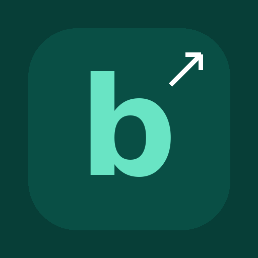
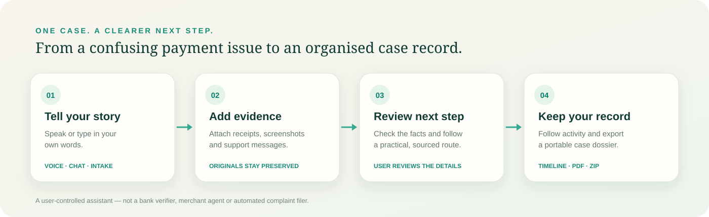
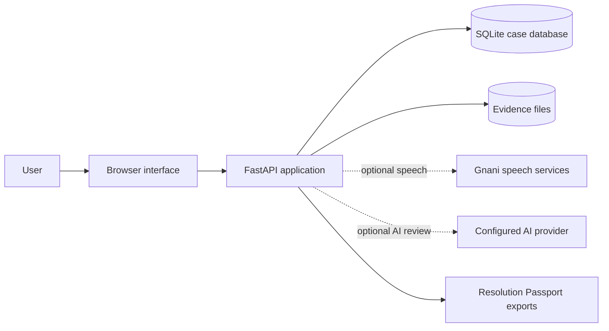
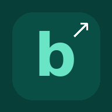

<!--
  BolKeResolve README
  Product overview, workflow, setup and honest capability boundaries.
-->

<div align="center">
  
  <h1>BolKeResolve</h1>
  <p><strong>From payment confusion to a clearer next step.</strong></p>
  <p>
    A voice-first, evidence-aware case workspace for everyday payment and refund issues in India.
  </p>
  <p>
    <a href="https://github.com/Prakash-codeMaker/BolKeResolve"></a>
    
    
  </p>
  <p>
    <a href="#how-it-works">How it works</a> ·
    <a href="#product-capabilities">Capabilities</a> ·
    <a href="#run-locally">Run locally</a> ·
    <a href="#deployment">Deployment</a>
  </p>
</div>

---

## The problem

A failed UPI payment, a delayed refund or an unfamiliar charge can quickly turn into a confusing chain of screenshots, messages, reference numbers and support conversations.

People often have the information they need, but it is scattered—and it is not always clear what to check or do next.

**BolKeResolve helps bring that information together.** Explain the issue in your own words, add the records you already have, review the important details and keep a structured case history with a practical next step.

> One conversation. Your evidence. A clearer next move.

## How it works

<p align="center">
  
</p>

1. **Tell your story.** Start with voice, Guided Chat or the issue form. You can use familiar language and leave unknown details blank.
2. **Add evidence.** Attach receipts, screenshots, PDFs, recordings or support messages. Review extracted information before confirming it.
3. **Review the next step.** BolKeResolve uses the available case details and resolution playbooks to suggest a practical, source-linked action.
4. **Keep your record.** Continue the case timeline, record follow-ups and export a portable Resolution Passport.

## Product capabilities

| Area | What it does |
|---|---|
| **Live Resolution** | Voice-led case intake with typed input, transcript review, optional camera/document/screen capture and a case-specific next-step panel. |
| **Guided Chat** | A WhatsApp-style in-site conversation. Speak or type, choose a supported speech language when configured, and save the reviewed conversation to a case. |
| **Issue guidance** | Deterministic first-pass playbooks for common failed-payment, pending-payment, delayed-refund, duplicate-charge and related issues. |
| **Evidence workspace** | Case-linked files, previews, metadata, extraction review, provenance labels and relationships between evidence and claims. |
| **Case timeline** | A chronological history of conversation turns, user-confirmed facts, support contacts, follow-ups and case events. |
| **Resolution Passport** | Structured JSON and printable case summary, plus ZIP exports containing selected case records and original evidence. |
| **Accounts** | Sign-up, sign-in, sessions, account-scoped cases, email verification and password recovery when SMTP is configured. |

### See the product

<p align="center">
  <a href="docs/assets/readme/issue-intake.webp">
    
  </a>
  <a href="docs/assets/readme/guided-chat.webp">
    
  </a>
</p>
<p align="center">
  <a href="docs/assets/readme/live-workspace-preview.webp">
    
  </a>
</p>

These are screenshots of the product interface. Names, amounts and case details shown in demonstrations are illustrative; they are not customer testimonials or proof of a real payment outcome.

## What makes the case record useful?

BolKeResolve is designed to keep related information together instead of leaving it scattered across chat messages and file uploads.

- **Facts retain their source.** A user statement, an extracted candidate and a user-confirmed fact are not treated as the same thing.
- **Original evidence is preserved.** OCR, transcription, redaction and AI observations are derivatives; they should not silently replace the original file.
- **Corrections remain traceable.** Important fact and transcript changes retain history instead of silently overwriting earlier information.
- **Claims can be linked to evidence.** A file can support, contradict or provide context for a particular claim.
- **Exports stay structured.** The Resolution Passport combines the summary, timeline, facts, conversation and evidence index.

## Resolution Passport

A case can be exported so the user can continue the conversation with the relevant support channel or organisation outside BolKeResolve.

The export can include:

- Case summary, status and next action
- Chronological timeline and conversation transcript
- User-confirmed facts and superseded/disputed details
- Evidence index and original uploaded files
- Available extraction/transcript derivatives
- Export manifest and SHA-256 file hashes

The package is a **user-assembled case record**. A hash can help detect whether a file changed; it does not prove who created the file, when it was created or whether its contents are true. The export is not a certified legal record.

See [Resolution Passport and no-API handoff](docs/RESOLUTION_PASSPORT_AND_NO_API_HANDOFF.md).

## Architecture



**Current stack**

- **Frontend:** HTML, CSS and JavaScript; responsive browser experience and PWA shell.
- **Backend:** Python and FastAPI.
- **Persistence:** SQLite database and case-scoped evidence files.
- **Speech:** optional server-side Gnani Prisma speech-to-text and Timbre text-to-speech integrations.
- **Optional AI features:** separately configured AI case understanding, image review and translation features.

Provider credentials belong in the server environment. They must never be placed in frontend JavaScript or committed to Git.

## Run locally

### Windows

1. Download or clone this repository.
2. Open the project folder.
3. Double-click `run_windows.bat`.
4. On first launch, the script creates the virtual environment and installs the Python requirements.
5. Open **http://127.0.0.1:8000** in Chrome.
6. Create an account from the header and start a sample case.

The supplied `.env.example` contains local development defaults. The launcher copies it to `.env` only when `.env` does not already exist.

### Configure optional speech

1. Open your local `.env`.
2. Add your own key to `GNANI_API_KEY`.
3. Save the file and restart the application.
4. Test with non-sensitive sample audio.

The speech key is read by the backend. Do not add it to browser code.

### Configure optional AI assistance

AI case understanding, image review and translation are separate from speech transcription. They require their own configured AI provider and the relevant user consent. If they are not configured, the interface should explain that clearly; the core case workflow remains usable.

### Tests and checks

From the project root:

```bash
python -m pytest -q
python -m compileall -q backend
node --check frontend/app.js
node --check frontend/sw.js
python scripts/check_release_readiness.py
```

See [IMPLEMENTATION_STATUS.md](IMPLEMENTATION_STATUS.md) for the latest recorded checks and outstanding validation.

## Deployment

The recommended hosting split for the current storage architecture is:

- **Vercel:** static frontend from `frontend/`.
- **Render:** FastAPI backend with the persistent disk used for SQLite and uploaded evidence.
- **Vercel rewrite:** same-origin `/api/*` requests are forwarded to the Render service.

Do not deploy the current SQLite/local-file backend as a Vercel Function and expect its filesystem to persist.

Follow the repository's [Vercel + Render deployment guide](VERCEL_DEPLOYMENT_GUIDE.md). Before enabling real users, validate account registration, email delivery, uploads, evidence persistence after restart, exports and the Live Resolution WebSocket on the deployed Preview URL.

## Privacy, safety and capability boundaries

BolKeResolve is a case-organisation and guidance tool—not a bank, payment network, merchant support agent or legal representative.

- It does **not** independently verify a bank transaction, refund credit or settlement.
- It does **not** automatically contact a merchant, file a complaint or guarantee that a support message was delivered.
- A support message remains a draft until the user sends it through their chosen channel.
- OCR and AI output are observations or candidate facts, not proof. Users review and confirm details.
- File-signature checks are not malware scanning. Production uploads still need a real scanning/quarantine strategy.
- Do not enter OTPs, UPI PINs, passwords, full card details or other authentication secrets.
- Use synthetic or redacted data during demos and testing.

Before a public launch, the operator must complete the privacy notice, configure HTTPS and trusted origins, test email verification and password recovery, verify persistent storage and backups, and complete security/accessibility review. MFA/passkeys, managed object storage and malware scanning remain separate production-hardening work.

## Project structure

```text
BolKeResolve/
├── backend/                 # FastAPI routes, case logic and integrations
├── frontend/                # Browser application, styles and PWA shell
│   └── assets/              # Product artwork and local image fallbacks
├── tests/                   # Automated regression tests
├── docs/                    # Architecture, product and manual QA guides
├── scripts/                 # Release checks and operator utilities
├── render.yaml              # Render Blueprint
├── vercel.json              # Vercel frontend and API rewrite
├── requirements.txt         # Python dependencies
├── run_windows.bat          # Windows local launcher
└── .env.example              # Safe configuration template
```

## Documentation

| Guide | Purpose |
|---|---|
| [Live Resolution implementation](docs/LIVE_RESOLUTION_ROOM_IMPLEMENTATION_2026-10-31.md) | Voice session, evidence capture and case persistence |
| [Live Room smoke test](docs/LIVE_ROOM_END_TO_END_SMOKE_TEST.md) | Manual end-to-end test sequence |
| [Resolution Passport](docs/RESOLUTION_PASSPORT_AND_NO_API_HANDOFF.md) | Export structure and user-controlled handoff |
| [Evidence provenance](docs/EVIDENCE_PROVENANCE_AND_REPLY_REVIEW_2026-10-22.md) | Source labels, claim links and reply review |
| [Vercel + Render deployment](VERCEL_DEPLOYMENT_GUIDE.md) | Hosting configuration and release checks |
| [Implementation status](IMPLEMENTATION_STATUS.md) | Verified work and outstanding gates |
| [Asset credits](ASSET_CREDITS.md) | Image and artwork source record |

## Project status

BolKeResolve is an actively developed MVP. The recorded automated suite has passed **360 tests and 129 additional subtests** in the packaged release checks. That does not replace live provider verification, deployed-browser testing, backup-restore testing, security review or legal/privacy review.

Contributions, bug reports and usability feedback are welcome. Please do not include real customer records, credentials or payment secrets in public issues.

---

<div align="center">
  
  <p><strong>BolKeResolve</strong><br/>A clearer next step, with your case kept together.</p>
</div>
