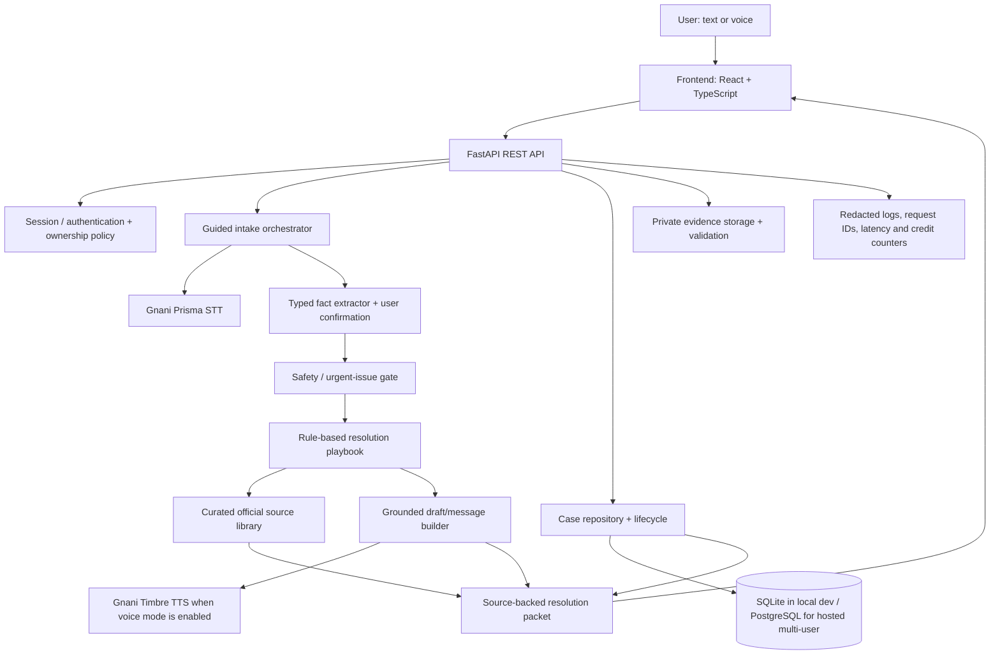

# BolKeResolve — Deep Research, First-Principles Product Blueprint, and Rebuild Plan

**Prepared:** 17 October 2026  
**Project:** BolKeResolve MVP Visual Refresh  
**Objective:** Turn the existing prototype into a complete, trustworthy, competition-ready voice-first payment-resolution product for the Great Indian AI Internship Challenge.

---

## Executive decision

**Do not throw away the current project, and do not keep polishing the homepage while the product's main intelligence is missing.** Preserve the current FastAPI and SQLite foundation, freeze the existing user journey as a baseline, then build a real resolution workflow around it. Make the backend's behavior, case lifecycle, source-grounded guidance, and live Gnani integration correct before adding more visual spectacle.

The product promise should be:

> **Tell BolKeResolve what happened in your own words. It helps you understand the next step, prepare the information and message you need, and keep track of what you have done.**

This is a resolution companion, not a bank, payment network, complaint authority, legal adviser, or automated refund service. It must not claim to verify a transaction, submit a complaint, contact a bank, or recover money unless an actual integration has performed that action and returned a verifiable result.

The strongest differentiation is **guided, voice-first, source-backed resolution across fragmented support journeys**, rather than another generic chatbot or UPI FAQ page.

### What is true today

- The ZIP has a real local application: a static HTML/CSS/JavaScript frontend, a FastAPI backend, SQLite case storage, evidence upload, timeline notes, templated support drafts, and code paths for Gnani Prisma speech-to-text and Timbre text-to-speech.
- The current frontend can record audio, package it as WAV, send it to the backend and display the returned transcript. The API call uses Gnani's documented REST endpoint and keeps the API key on the server.
- **Those voice integrations are not production-verified.** The packaged project has no real API key, and no live Prisma/Timbre call has been demonstrated from this archive. Until a real credential is configured and smoke-tested with synthetic speech, mark voice AI as *wired but unverified*, not complete.
- The WhatsApp-style chat is scripted browser logic, not an intelligent multi-turn assistant and not a real two-way WhatsApp Business API integration.
- The current product does not contain an official-source library or a resolution engine that maps a specific problem to reliable, source-backed next steps.
- The current build has no authentication or per-user access control. The API lists all cases and evidence can be fetched without authentication. It must remain local/synthetic-data-only until that is fixed.

---

## 1. Archive and code-level baseline

### 1.1 Inventory

The archive contains 21 ZIP entries, including directories, and 15 files. The core files are:

| File | Approximate size | Current role | Assessment |
|---|---:|---|---|
| `frontend/index.html` | 24 KB | Whole interface: landing page, intake, chat-style flow, case list and detail view | Complete enough as a prototype shell; several screens need to become real product workflows. |
| `frontend/app.js` | 30 KB | Recording, API requests, UI navigation, case creation, scripted chat and rendering | Too much application behavior in one file, with state handled manually. |
| `frontend/styles.css` | 49 KB | Base visual system and responsive styling | Contains useful visual work but should be audited and consolidated. |
| `frontend/design-v2.css` | 20 KB | Newer override layer loaded after `styles.css` | Creates a patch-over-patch styling system; merge into a coherent design system after the target screens are agreed. |
| `backend/main.py` | 19 KB | FastAPI app, SQLite schema, Gnani STT/TTS calls, CRUD, file uploads and templated drafts | One module handles too many concerns. Keep FastAPI, split responsibilities into small modules after endpoint contracts are stable. |
| `requirements.txt` | 102 bytes | Python dependencies | Minimal and appropriate for an MVP. |
| `run_windows.bat` | 380 bytes | Creates venv, installs requirements on first run, starts Uvicorn | Useful local launch path; test it from a clean extraction. |
| `README.md` | 6.6 KB | Setup, route list, model notes and limitations | Good honesty about current limitations; update it with verified status once features really work. |
| `.env.example` | 495 bytes | Secret/config template | Good pattern; do not ever put secrets in the frontend or commit `.env`. |
| `frontend/assets/` | 5 local fallback images | Fallback photography and guide artwork | Helpful for reliability; review licensing, optimize and avoid loading multiple redundant images. |
| `ASSET_CREDITS.md` | 2.7 KB | Asset credit notes | Retain and extend it for any newly created or sourced visuals. |

There is no `package.json`, frontend build step, React/Vue component tree, automated test suite, migration system, auth system, or source/rules corpus. Runtime data is not part of the ZIP; the app creates a `runtime/` directory for SQLite and evidence on launch.

### 1.2 Current backend structure

The SQLite database currently has three tables:

- `cases`: user-entered problem, merchant, amount, payment date, language, description, status and support draft.
- `evidence`: filename, stored filename, MIME type, size, timestamp and case relation.
- `timeline`: case events and user notes.

Current routes include `/api/health`, `/api/voice/transcribe`, `/api/voice/speak`, case list/create/detail, evidence upload/download, support-draft creation, and timeline notes.

This is a workable local base, but it is not yet a complete application domain. There is no conversation-turn store, structured fact/provenance model, source reference data, versioned playbook, draft history, ownership model, status-update endpoint, case-update endpoint, delete/export flow, or test coverage.

### 1.3 Important code-level findings

1. **Environment loading order bug:** `DATA_DIR` is read before `load_dotenv(ROOT / ".env")`. Therefore, putting `BOLKE_DATA_DIR` only in `.env` will not affect the directory selected during module import. Load settings before deriving paths, ideally through one validated settings object.
2. **Configured is not the same as healthy:** `/api/health` reports Gnani as configured merely when `GNANI_API_KEY` exists. It does not check credentials, credits, API reachability, or model availability. The UI should say “key configured” unless an actual readiness check has succeeded.
3. **Case status is being used as the last action:** creation sets `Received`, evidence upload overwrites it with `Evidence added`, and draft creation overwrites it with `Support draft ready`. That makes status a mixture of workflow state and activity history. The case list filters out `Resolved by user`, but the current backend never sets that status. In practice, open-case counts will be misleading.
4. **Hinglish draft option is accepted but not implemented:** the request schema accepts `en`, `hi`, and `hinglish`, but the generator has a Hindi branch and otherwise falls back to English. A request for Hinglish therefore receives the English template.
5. **The chat is not conversational intelligence:** `waGuessIssue()` uses regular expressions and the assistant replies with fixed strings. The code can collect story fragments and create a case, but cannot understand context, ask context-aware questions, verify extracted fields, or decide a grounded next action.
6. **The draft is generic:** `make_support_draft()` uses the case ID, issue label, amount and user description. It does not use issue-specific procedures, a verified-source corpus, a checklist for missing evidence, or a source citation.
7. **Evidence validation is prototype-grade:** extension and file-signature checks and size caps are present, which is useful. There is no authenticated ownership check, malware scanning, storage quota, retention/deletion policy, or content-disarm workflow. The current route comments explicitly state that evidence fetch is local-only.
8. **No user separation:** `GET /api/cases` returns all cases from the database, and case detail/evidence endpoints do not confirm ownership. If deployed publicly, one visitor could read another visitor's submitted story and files. This is a P0 blocker for public use.
9. **The current voice path is batch-on-stop:** the browser records PCM, constructs WAV, and then calls the REST endpoint after recording ends. It is not streaming partial transcripts or a realtime voice conversation. That is fine for a reliable first version; do not confuse a waveform animation with realtime AI.
10. **The recording implementation uses `ScriptProcessorNode`:** it can work for the prototype, but it is a legacy Web Audio approach. Keep the current WAV pipeline until live API tests pass; consider moving to `AudioWorklet` when building the streaming version, rather than changing audio processing and model integration at the same time.
11. **External photos are part of the presentation path:** they have local fallbacks, but visual consistency still depends on external image hosting. The final app should use compressed local/optimized assets and retain attribution records.
12. **The WhatsApp label needs honesty:** the internal flow is a chat-style intake UI; the external “Open WhatsApp” control opens a prefilled `wa.me` message. There is no live two-way WhatsApp Cloud API webhook implementation in this ZIP. In-app text should clearly distinguish the demo chat flow from the actual external WhatsApp handoff.
13. **`safeDataCheck` is only a frontend acknowledgement:** it helps communicate the rules but is not backend enforcement, stored consent, or security. Do not present it as a protective control by itself.

### 1.4 Baseline maturity ratings

These are engineering estimates based on the source, not external rankings or measured user outcomes. A feature is not “done” because code exists; it is done when the end-to-end flow is tested with the real dependency and failure modes.

| Area | Current estimate | Why it is not yet 10/10 |
|---|---:|---|
| Marketing-page visual shell | 6/10 | Clear direction and good asset fallback behavior, but the workspace screens are not designed around the final resolution journey. |
| Frontend state and interaction architecture | 3/10 | Manual state and rendering in a single script; scripted chat; no E2E tests. |
| Case CRUD and local persistence | 6/10 | Create/list/detail/evidence/timeline/draft work locally, but update/delete, user ownership and a correct lifecycle are missing. |
| Real Gnani STT/TTS product integration | 2–3/10 | API wrappers and WAV recording are present, but live calls, supported-language behavior, latency, errors and credits have not been verified. |
| Conversational intelligence | 1/10 | Fixed responses and keyword selection, no structured context or follow-up logic. |
| Issue-specific official guidance | 0–1/10 | No curated source library or issue playbooks. |
| Evidence-aware workflow | 2/10 | Upload and basic checks exist, but no OCR, extraction/provenance, completeness checklist or safe share/export packet. |
| Security and privacy | 1/10 | Local-only limitations acknowledged; no authentication/ownership, public deployment hardening or deletion/retention support. |
| Automated testing/observability | 0–1/10 | No tests, metrics, request correlation strategy or documented quality benchmark in the archive. |
| Competition readiness | Not evidenced | The ZIP does not prove live model calls, a real working demo video, public post, or submission have been completed. |

**Interpretation:** the app is a useful shell and storage prototype. The work ahead is product logic, real AI integration verification, reliability, security and demonstrating the complete workflow.

---

## 2. First-principles product strategy

### 2.1 Start from the user's actual problem

The user does not wake up wanting “an AI chatbot.” They have an unresolved problem and lack some combination of:

- a clear way to explain what happened;
- confidence about what information matters;
- knowledge of which provider or official route is relevant;
- an organised set of proof and contact history;
- a usable message to send;
- clarity about what they have done, what is pending, and what to do next.

Our product must reduce that confusion. Voice is an accessibility and friction-reduction mechanism. AI is a way to interpret the user's story and help prepare the correct next step. It is not the product value by itself.

### 2.2 The outcome to optimise for

The main success measure should be:

> **Can a user move from a confusing payment story to a clear, source-backed, user-approved next action and a complete record of their follow-up?**

Do not use “money recovered” as the product's direct success metric because BolKeResolve does not control the bank, merchant, payment rail or complaint authority. In the demo, the result may be a prepared and user-reviewed complaint packet, a link to the appropriate official channel, and a timeline entry showing that the user says they submitted it.

### 2.3 Positioning

**Recommended description:** “BolKeResolve is a multilingual, voice-first payment-resolution companion that organises a user's story and evidence, then guides them to the next appropriate step with source-backed guidance.”

It should not claim to be a payment processor, a bank, an official complaint portal, an automated transaction verification service or a guarantee of reimbursement.

### 2.4 The signature feature: a Proof-Led Resolution Packet

For each supported issue, generate a compact packet containing:

1. **What we understood** — the user's confirmed story in plain language.
2. **What we still need** — only the essential missing facts.
3. **What to do next** — a specific, issue-appropriate action.
4. **Why this step** — cited official source(s), section/page where practical, last-checked date and applicable caveat.
5. **What to prepare** — relevant details and supporting evidence, without collecting OTPs, PINs, full card data or credentials in BolKeResolve.
6. **Your message** — an editable, correctly formatted draft with no invented facts.
7. **Your progress** — user-controlled status and timeline.

Each fact should have provenance such as `user_entered`, `voice_transcript_unconfirmed`, `user_confirmed`, `ocr_extracted_unconfirmed`, or `official_source`. The product must not visually blend a transcript, an inference and a verified fact into one certainty level.

### 2.5 Choose narrow, complete issue flows

Do not attempt to support every financial complaint category equally in the first release. Build three strong flows, with clear boundaries:

**Flow A — Failed UPI transfer / amount debited, receiver not credited.** Ask about the payer app/bank, approximate date/time, amount and whether the transaction status is visible. Let the user review their wording and redact sensitive evidence. Provide the right first contact route and explain how to use official status/complaint channels. Do not claim to know transaction status.

**Flow B — Merchant/order refund delayed.** Ask whether the purchase/order was cancelled, when the refund was promised, whether the merchant has already been contacted and whether an acknowledgement/ticket exists. Prepare a structured complaint and evidence checklist. Explain appropriate consumer-grievance escalation, with conditions and official links, not a generic “go to RBI” answer.

**Flow C — Suspected unauthorised transaction or payment scam.** Safety-first fast path: immediately display the official bank contact route and the Government of India's cyber-fraud reporting route. Do not make the user complete a long chat before seeing the urgent step. The National Cyber Crime Reporting Portal currently directs users to call 1930 for immediate reporting of cyber financial fraud: https://cybercrime.gov.in/ (official page: https://cybercrime.gov.in/Accept.aspx/Webform/Webform/Webform/Webform/Webform/Webform/FAQ.aspx). The flow must not ask for OTPs, UPI PINs or passwords.

All three flows should run through the same underlying intake, source-selection, draft, evidence and status systems. Add more issue types only when these flows have tests and source review.

---

## 3. Research: the surrounding product landscape

The following are not all direct competitors. Some are official destination systems we should help users navigate, not replace.

### 3.1 NPCI UPI HELP / FiMI — the most important product overlap

NPCI's October 2025 UPI HELP pilot circular says the assistant is meant to answer digital-payment questions, let users check UPI transaction status, log/track supported service complaints, and manage UPI mandates through supported routes. NPCI's February 2026 announcement says FiMI, a payment-domain-specific model, powers UPI HELP and supports English, Hindi, Telugu and Bengali at that stage.

Sources:
- NPCI UPI HELP pilot circular: https://www.npci.org.in/uploads/UPI_OC_No_227_FY_2025_26_Introduction_of_UPI_HELP_Assistant_pilot_an_AI_powered_support_for_UPI_payments_cd501de8f3.pdf
- NPCI FiMI announcement: https://www.npci.org.in/uploads/NPCI_announces_Fi_MI_a_domain_specific_AI_language_Model_built_for_India_s_payments_ecosystem_fbc0ab607b.pdf

**Implication:** do not position BolKeResolve as “a better UPI FAQ chatbot.” UPI HELP has an institutional role and potential access to payment systems that our prototype does not have. Our credible wedge is the guided preparation and follow-up layer: explain the story in the user's language, confirm details, assemble evidence and a good complaint message, cite the appropriate source, and keep the user's history together across relevant merchant/provider steps.

Do not claim the NPCI pilot is universally available to every user or every bank; its circular describes access through participating members and a pilot programme.

### 3.2 National Consumer Helpline 2.0 — the official consumer escalation ecosystem

The National Consumer Helpline provides multiple channels, including web, app, UMANG and WhatsApp, plus complaint tracking. Its website advertises 17 languages and omni-channel access.

Sources:
- Official site: https://consumerhelpline.gov.in/public/
- Contact channels: https://consumerhelpline.gov.in/public/index.php/contact
- Track complaint: https://consumerhelpline.gov.in/user/track-complaint.php

**Implication:** BolKeResolve should link users to the official NCH channel when it fits. The app should make it easier to prepare and understand a complaint, not pretend to be the government portal or register on the user's behalf without a real authorised integration.

### 3.3 RBI Complaint Management System and RB-IOS 2026

The Reserve Bank issued the Reserve Bank — Integrated Ombudsman Scheme 2026 on 16 January 2026, with effect from 1 July 2026. Its official FAQ explains that a complainant generally must first approach the concerned regulated entity with proof. The FAQ says an RBI Ombudsman complaint can be filed where the entity does not reply within 30 days or the applicable longer timeline, or the user is dissatisfied with the reply/resolution. It also notes a 90-day filing window measured from the relevant expired timeline or last communication, whichever is later, subject to the scheme's conditions.

Sources:
- RBI issue announcement: https://www.rbi.org.in/Scripts/BS_PressReleaseDisplay.aspx?prid=62052
- RBI 2026 scheme FAQ PDF: https://www.rbi.org.in/commonman/Upload/English/FAQs/PDFs/RBIOS01072026.pdf
- RBI complaints page: https://rbi.org.in/Scripts/Complaints.aspx

**Implication:** the resolution engine must be conditional and source-backed. Do not hardcode “wait 30 days and go to RBI” as the response to every issue. Different products and transaction types can have their own process/timeline; the Scheme has maintainability rules and exclusions. The assistant needs to ask whether the user already contacted the regulated entity, record the date and acknowledgement, and show source dates and caveats. Official-source content needs a review date and version, because procedures change.

The RBI FAQ also explains the information required for an Ombudsman complaint, including entity details, acknowledgement, relevant transaction details, previous reply (if any), facts, relief sought and supporting documents. This informs the structure of a *user-reviewed* case packet, but is not a reason to collect every sensitive field inside BolKeResolve.

### 3.4 NPCI complaint portal / UPI FAQ

NPCI's UPI FAQ says users can raise a grievance or check transaction status through the UPI app of participating banks. Its complaint portal says complaints about fraudulent/unidentified/unauthorised transactions should be raised with the user's bank, and clarifies that member banks/institutions are responsible for resolving the complaint made available to them.

Sources:
- NPCI UPI FAQ: https://www.npci.org.in/what-we-do/upi/faqs
- NPCI register a complaint: https://www.npci.org.in/register-a-complaint

**Implication:** official routes depend on the issue and responsible provider. A generated message should not state that NPCI or RBI has verified the transaction. For suspicious/unrecognised payments, guide the user promptly to their bank's official contact route; show the 1930 reporting route for suspected cyber financial fraud.

### 3.5 Complaint/dispute flows from established financial apps

Revolut's public dispute guidance tells users to contact the merchant first for common cancellation/refund/wrong-charge issues, gather the merchant response as evidence, select the transaction, choose an issue, complete the form, and track the dispute in-app.

Sources:
- https://help.revolut.com/help/card-payments-withdrawals/refunds/dispute-a-card-transaction/
- https://help.revolut.com/en-IN/help/other-topics/question-how-do-i-complain/

**Pattern worth learning:** issue-specific progressive disclosure; transaction context; evidence before escalation; precise status changes; and visible next actions. We should not copy their UI or assume their card-payment flow applies to Indian UPI. We should generalise the workflow pattern into our own original product.

### 3.6 US CFPB complaint process as a product-pattern reference

The CFPB process describes submission, routing, company response, status updates and consumer review as explicit steps. Its complaint portal also supports status checking.

Source: https://www.consumerfinance.gov/complaint/process/

**Pattern worth learning:** users should see the actual stage of their process and what event caused a status change. For BolKeResolve, “I marked this as submitted” is different from “the recipient received it,” and both are different from “the institution resolved the complaint.”

---

## 4. Public GitHub projects for the same Gnani AI challenge

These repositories publicly describe projects built for or around the Great Indian AI Internship Challenge. A public repository is not proof of an official submission, shortlist, award or working deployment. README claims are author claims unless the underlying test/demo was independently reproduced.

### 4.1 Kural — Tamil-first government-scheme voice helpline

Repository: https://github.com/Mirdumurugesan/kural  
GitHub size metadata observed: about 8,286 KB.

README describes a Tamil/Tanglish/English voice helpline with Prisma v2.5 STT, Timbre TTS and Evon reasoning; retrieval over official scheme documents; citations; human escalation tickets; phone-audio degradation/noise testing; PII redaction; rate limiting; a credit budget; Docker and an automated test suite. Its README reports a 20/20 top-1 result on a 20-question test set—an author-reported benchmark, not one reproduced in this audit.

The public source tree includes tests for API behavior, source-backed answers, out-of-scope escalation, PII redaction, mock voice input, rate limiting and credit-budget enforcement.

**What to learn:**
- A grounded answer with a source is more credible than an unqualified model answer.
- A graceful fallback and explicit escalation path can be a feature, not a failure.
- Test the safety and product behavior, not just whether an API returns 200.
- Measure audio/noise behavior and credit usage; don't claim robustness only because the speech API accepts a file.

**What not to blindly copy:** Kural's Tamil government-scheme domain and retrieval corpus are different from payment complaints. Hosting a 30B reasoning model, telephony and advanced noise processing is a high-complexity path and should not block our first working product.

### 4.2 SunoAI — support-call quality review

Repository: https://github.com/neha-tanti/sunoai  
GitHub size metadata observed: about 773 KB.

Its README says it analyses recorded food-delivery/quick-commerce support calls for red flags, customer frustration, checklist outcomes with transcript quotes, AI-agent fixes and human coaching in the agent's language. The repository has a Product Requirements Document and Technical Requirements Document, and specifies a Next.js frontend, Hono API, Supabase storage/auth/database, tests and a multi-step processing pipeline. Its README labels the project pre-production and says features are being built; documentation and breadth should not be read as proof every feature runs end to end.

**What to learn:** define success criteria and non-goals before adding features; show quotes/evidence behind conclusions; design explicit lifecycle states; use an authenticated private database/storage model; and build automated tests alongside the API.

### 4.3 KisanSetu — multilingual agricultural voice assistant

Repository: https://github.com/aniket25042005/kisan_setu_gnani_ai_challenge  
GitHub size metadata observed: about 54 KB.

README describes a farmer-facing voice desk using Prisma and Timbre, with agricultural reasoning, mandi price lookup, crop health and government-scheme guidance. The backend tree includes a Gnani client, an audio processor, a reasoning module and test pipeline.

The public test file covers examples of mandi intent, crop-health intent, scheme intent, Marathi query handling and TTS synthesis. The actual external calls still depend on real credentials and data/service configuration.

**What to learn:** keep the provider client, domain reasoner, audio processing and UI controller separate. Make the product useful in specific scenarios, but clearly indicate the freshness and provenance of market or scheme information.

### 4.4 Kirana Voice Orders — deterministic voice ordering

Repository: https://github.com/sagar-grv/kirana-voice-orders  
GitHub size metadata observed: about 151 KB.

README describes a flow from spoken customer order to Prisma transcript, a rule-based multilingual parser, calculated total, and Timbre spoken confirmation. The parser and test file are separate. Its tests cover Hindi, Hinglish, English, missing quantities, native-script digits, half quantities, Tamil/Malayalam examples and language detection.

**What to learn:** money-related values should be deterministically extracted where possible and shown for confirmation. If a quantity/amount is not stated, flag it rather than silently turning a guess into a fact. For BolKeResolve, amounts and dates must be editable before they appear in the final draft.

### 4.5 Voice Ops Line — simple Hinglish field reporting

Repository: https://github.com/Sivadheeraj5356/gnani-voice-ops-line  
GitHub size metadata observed: about 11 KB.

A small Python script provides a voice reporting line for field crews. Its pipeline is Prisma transcription → deterministic structuring into site/workers/hours/issues → JSONL storage and dashboard → optional Timbre readback. It has mock-provider behavior so the workflow can be exercised without credits. Its README says live API exercise is pending.

**What to learn:** a narrow, complete workflow with deterministic critical fields can be more convincing than a large feature list. Mock providers support repeatable tests, but the final competition demonstration must still show genuine Gnani model/API use.

### 4.6 Kavach — real-time voice scam threat intelligence

Repository: https://github.com/abhishek-pandey7/Kavach-Realtime-Voice-Threat-Intelligence  
GitHub size metadata observed: about 239 KB.

README describes live detection of multilingual scam scripts with Prisma streaming STT, Evon reasoning, Timbre speech warnings, family alerts and a post-call report. It distinguishes a speakerphone-based guardian mode from a planned telephony-provider merge-in mode; some integrations are explicitly planned rather than shipped. It claims the project's staged/synthetic data is consented.

**What to learn:** a vivid, high-stakes user story and an immediate action can make a demo memorable. But live call monitoring, call injection, cloned voices and telephony integration bring safety, consent and engineering complexity. We should borrow the clarity of the problem story, not the entire scope.

### 4.7 Samasya — voice-driven puzzle games

Repository: https://github.com/DreadVoice/samasya  
GitHub size metadata observed: about 26 KB.

README describes six voice-driven puzzle games and a TypeScript/Cloudflare Worker architecture, but explicitly says the code under `src` is scaffolded with signatures/types/TODOs and has no implementations yet.

**What to learn:** separate “planned” from “implemented” rigorously. A large architecture diagram or long README should not be counted as product progress.

### 4.8 JeevanRaksha AI — disaster-relief voice assistant

Repository: https://github.com/aasutoshsony/jeevanraksha-ai  
GitHub size metadata observed: about 78,068 KB.

README describes a Streamlit/SQLite MVP for voice reporting emergency needs, prioritisation and a relief-team dashboard, and explicitly says it is not connected to live emergency services.

**What to learn:** make the operational boundary explicit. A real user-facing app should disclose whether it merely records a request or actually submits it to an authority. The relatively large repository-size metadata is not a quality score; inspect assets/dependencies before using repository size as a proxy for implementation depth.

### Competitor conclusion

The most valuable pattern across the better-documented projects is: **a concrete problem, a short end-to-end pipeline, a real Gnani API, clear data flow, explicit fallbacks, visible evidence/sources, tests and a convincing demo.** We should not copy a peer's product idea or source code. Use public examples to learn design and engineering patterns, then build our own product and document our own contributions.

---

## 5. Gnani AI integration research and decisions

Official sources:
- Prisma STT REST: https://docs.gnani.ai/api/STT/speech-to-text
- Prisma STT Realtime WebSocket: https://docs.gnani.ai/api/STT/stt-websocket
- Prisma Batch STT: https://docs.gnani.ai/api/STT/stt-batch
- Timbre TTS REST: https://docs.gnani.ai/api/TTS/tts-inference
- Timbre TTS streaming: https://docs.gnani.ai/api/TTS/tts-sse
- Timbre TTS realtime: https://docs.gnani.ai/api/TTS/tts-websocket
- Challenge page and current rules: https://www.gnani.ai/internship

### 5.1 Prisma speech-to-text

The documented REST endpoint is `POST https://api.vachana.ai/stt/v3`, with the key in `X-API-Key-ID` and `audio_file` plus `language_code` as multipart fields. Current docs list WAV, MP3, OGG, FLAC, AAC and M4A, with a maximum duration of 60 seconds and an ideal clip around 30 seconds. The `format=transcribe` option enables inverse text normalisation for numbers/currency/dates, which is suitable for payment stories, but every extracted amount still needs user confirmation.

The existing code's use of `audio_file`, `language_code`, `format=transcribe`, a server-side key and a browser-generated WAV is aligned with that documented REST contract. **What is missing is live verification and a proper test set, not the presence of a basic wrapper.**

Recommended first version:
- Keep push-to-talk / stop-to-transcribe for the first reliable user flow.
- Show the full transcript in an editable field; highlight amounts/dates as *unconfirmed* until the user approves them.
- Provide a fully working type-in fallback.
- Record request ID, endpoint duration, response status and safe error category; do not log raw audio or the entire complaint text.
- Handle missing key, invalid format, empty transcript, permission denial, rate limit and temporary service failure with friendly actionable messages.
- Use bounded retries/backoff only for transient errors; don't retry invalid credentials or invalid input.

The REST endpoint is a good first choice for short pre-recorded clips. The realtime WebSocket is intended for live microphone/audio streaming. Gnani's current realtime docs say browser WebSockets cannot set custom headers, so the connection must be proxied through our own backend to keep the API key out of the browser. A WebSocket implementation should be a later, measured improvement—not the first thing that delays a complete guided product.

### 5.2 Timbre text-to-speech

The current server code calls the Timbre v2.5 REST endpoint and returns the audio file; the browser plays it. This is a valid baseline pattern, but it only demonstrates read-aloud of a generated support draft, not a spoken assistant conversation.

The next version should use TTS for assistant replies when the user selects voice mode, with replay/pause controls and no forced playback. The voice should match the response language. Current docs list multiple v2.5 voices and also expose Timbre v3.0; keep v2.5 as the baseline until the user's actual credentials/credits and target-language voice have been tested, then compare v3.0 only if it is available to the challenge account. Do not assume a model listed in public docs is automatically enabled on the participant's account.

TTS text needs its own speakable formatting. Gnani's docs specifically warn that raw numbers, IDs, dates and currency may be mispronounced; convert amounts/dates into natural spoken form for audio while keeping numerals in the written case record. Use a language/voice mapping rather than one voice for every supported language. For Hinglish, test a suitable Hinglish voice/language setting (the current docs list `Poorvi` as a Hinglish example) against recorded examples.

### 5.3 Evon reasoning model

The challenge page describes Evon v3.3 as open-weight and available by request on Hugging Face. A 30B-class model is not a sensible assumption for a typical 8 GB laptop to host locally. First ask Gnani/participant support whether the challenge account provides a hosted inference option or access route. Do not block a complete app on running a large model locally.

If Evon is accessible, use it narrowly for structured transcript normalisation, language-aware conversational paraphrases, or draft refinement—then validate its output against a strict schema and known user facts. It must not decide regulatory eligibility or invent time limits from memory. If access is not available in time, a deterministic guided conversation and versioned source playbooks can produce a credible, testable MVP while still using Prisma and Timbre genuinely.

### 5.4 Image-to-text / screenshot interpretation

Do not add an image model merely because it is available. Evidence OCR has a clear potential job: suggest fields such as amount, date, merchant and transaction reference from a screenshot, so the user does not type them again. It must remain optional and reviewable.

Recommended sequence:
1. Support secure upload and evidence listing first.
2. Add text extraction/OCR for image/PDF evidence only after the voice-to-resolution flow works end to end.
3. Return `field`, `value`, `confidence`, `source_file`, and a visible “please confirm” state for every extracted field.
4. Do not claim OCR verifies payment status. Do not send personal screenshots to a new external image model without explicit consent, clear disclosure and appropriate privacy review.
5. Exclude OTPs, UPI PINs, passwords and full payment credentials; warn users not to upload them.

A full visual-language model and a vector database are not prerequisites for the first version. A small official-source corpus is better served by explicit playbooks and source links than by adding a complex RAG stack prematurely.

---

## 6. Product workflow: the complete vertical slice

The highest-priority demo journey should work as one uninterrupted path.

### Step 1 — start naturally

The user chooses text or voice, selects a language or accepts a suggested language, and describes what happened. The UI explains why audio is recorded, asks for microphone permission only at the moment it is needed, shows recording state/time and provides a visible cancel/redo control.

### Step 2 — transcribe and confirm

Prisma returns the text. The user can edit it. The interface may highlight candidate facts—amount, date, app/provider, payment status—but never auto-lock them as facts. If the transcript is ambiguous, ask a simple clarification rather than silently correcting it.

### Step 3 — understand the issue as structured facts

An intake orchestrator should classify the issue into a small supported taxonomy and extract a compact schema such as:

```json
{
  "issue_type": "upi_debited_beneficiary_not_credited",
  "payment_rail": "upi",
  "amount_inr": 2000,
  "transaction_date": null,
  "provider": null,
  "user_reported_status": "debited_but_recipient_not_credited",
  "prior_contact": "unknown",
  "reference_available": false,
  "risk_flags": [],
  "missing_required_fields": ["transaction_date", "provider"],
  "confidence": "needs_user_confirmation"
}
```

This is an example target schema, not a claim about current extraction. Use Pydantic validation; reject invalid model output; keep unknown fields `null`; never invent numbers. The user confirms important facts before draft generation.

### Step 4 — choose the next best question

The system should ask only the most useful missing question for the active issue path. Keep the conversation short and stateful. The goal is not an open-ended chat session: it is to collect enough trustworthy information to recommend a safe next action.

A deterministic conversation manager can use issue-specific required fields and conditions. An optional reasoning model can propose structured values or wording, but the policy/playbook layer controls the next step. This separation makes it easier to test and safer to change.

### Step 5 — select a source-backed playbook

Each playbook should include:
- `issue_type` and included/excluded conditions;
- required and optional fields;
- urgent/risk branches;
- numbered actions in plain language;
- official citations/links for each procedural claim;
- when to contact the bank/provider/merchant/NCH/RBI/cybercrime channel;
- what evidence can help;
- source version, last-verified date, reviewer and review-due date;
- cases where the product must not make a recommendation and should refer to official help.

For the current release, implement 3–5 curated playbooks in version-controlled YAML/JSON or database records, rather than scraping the entire internet. Store source title, publisher, URL, relevant excerpt/section and validation date. Retrieval can start with a direct issue-to-playbook mapping and SQLite full-text search; vector RAG is optional only when the verified content base becomes too large for this approach.

### Step 6 — generate a draft from confirmed facts

A message builder should use confirmed case facts, selected playbook, and requested language. The draft includes only facts that the user has supplied and confirmed. It can state which details are missing; it cannot make claims such as “the bank failed to refund this” unless that has been established.

The user can edit, copy and choose an official destination. The product should say “Prepared—Not sent” until a verified integration actually submits a message and confirms delivery.

### Step 7 — attach evidence and build the packet

Evidence upload shows the filename, type, size, removal control and safe-data reminder. The resolution packet contains the message, evidence checklist, source cards and an optional export/share bundle. A file should be presented as *user-provided*, not verified proof, unless some independent verification exists.

### Step 8 — track progress honestly

Use an actual lifecycle, for example:

`draft` → `needs_details` → `ready_to_act` → `user_says_submitted` → `waiting_for_response` → `user_reports_resolved` / `user_reports_unresolved` → `closed_by_user`.

A status change should be an explicit user action or a confirmed external callback. Show the event in the timeline. Never use “Resolved” just because someone opened a page or generated a draft.

---

## 7. Recommended target architecture

### 7.1 Keep a modular monolith, not microservices

The deadline does not justify Kubernetes, a distributed queue for everything, or multiple backend services. We need one FastAPI service with clear modules, typed contracts and tests. That is enough to make it maintainable and fast for this MVP.



The AI should not own the state machine. It helps turn language into structured data; deterministic rules decide which questions/steps are allowed; verified source material determines the procedural claims; the user approves facts and actions.

### 7.2 Frontend recommendation

**Recommended controlled rebuild:** Vite + React + TypeScript for the single-page product, with Tailwind/CSS tokens and an accessible component set such as shadcn/ui where it genuinely saves time. Keep FastAPI as the backend and REST as the interface. Do not move the backend to Node.js or introduce Next.js/SSR only for fashion; this application is primarily an interactive tool, not a content site requiring server-rendered pages.

The current vanilla UI can stay in the archive as the visual reference until the new workspace screens replace it. Lock API contracts before migrating screens. A React rewrite should make it easier to isolate microphone controls, transcript review, issue questions, evidence cards, source references, timelines and status transitions, and to test each screen.

### 7.3 Suggested repository structure

```text
bolkeresolve/
  frontend/
    src/
      app/                 # routes, shell, application providers
      components/          # button, cards, dialog, upload, audio controls
      features/
        intake/             # chat steps, transcript review, fact confirmation
        cases/              # list, detail, lifecycle and timeline
        evidence/           # upload, preview, remove, OCR confirmation
        resolution/         # playbook, sources, action packet, draft editor
      styles/               # tokens, typography, motion, responsive system
      lib/                  # API client, schema validation, safe formatters
      tests/                # component and flow tests
  backend/
    main.py                 # app construction and route registration
    api/                    # versioned REST routers
    schemas/                # Pydantic request/response schemas
    services/
      gnani_stt.py
      gnani_tts.py
      intake.py
      fact_extraction.py
      risk_triage.py
      resolution_engine.py
      draft_builder.py
      source_library.py
      evidence_extraction.py # optional OCR later
    db/
      connection.py
      repositories.py
      migrations/             # schema changes
    knowledge/
      sources/                # official source metadata/excerpts
      playbooks/              # version-controlled workflow rules
    tests/
      unit/
      api/
      security/
      fixtures/               # synthetic transcripts/audio metadata
  docs/
    product-spec.md
    architecture.md
    threat-model.md
    evaluation.md
    demo-script.md
  .env.example
  README.md
```

This is the target shape, not a request to create empty folders just to look professional. Create a module only when there is a real responsibility for it.

### 7.4 Data model to add gradually

| Entity | Purpose | Critical fields |
|---|---|---|
| `users_or_sessions` | Isolate every visitor's information | owner/session ID, created/expiry, auth state |
| `cases` | User's issue and current lifecycle | owner ID, issue type, payment rail, amount stored safely, currency, dates, language, status, timestamps |
| `case_facts` or structured JSON | Store extracted facts with provenance | key, value, confidence, origin, confirmed flag, update time |
| `conversation_turns` | Preserve the structured conversation | case/session ID, role, content reference, language, event/turn ID, timestamp |
| `evidence` | Track uploaded files | case ID, private object key, MIME, size, SHA-256, scan state, timestamp |
| `evidence_extractions` | Optional OCR/metadata suggestions | evidence ID, field, candidate value, confidence, confirmed state |
| `timeline_events` | Audit user-visible workflow progress | case ID, event type, actor, message, structured metadata, timestamp |
| `drafts` | Versioned message output | case ID, language, text, playbook/source version, last edit, sent state |
| `knowledge_sources` / `playbook_versions` | Keep procedural guidance traceable | official URL, publisher, relevant section, checked date, version, supported issue types |
| `model_usage_events` | Measure reliability and cost | request ID, model/endpoint, duration, status, approximate usage/credits—no raw transcript logging |

For local development, SQLite remains fine. If deploying a multi-user service, migrate to managed PostgreSQL and private object storage rather than assuming one local SQLite file and one evidence directory are safe for concurrent public traffic.

### 7.5 API contracts to formalise

Version APIs (e.g. `/api/v1/...`) and use explicit request/response schemas. Likely routes:

- `GET /api/v1/health/live` and `GET /api/v1/health/ready`
- `POST /api/v1/voice/transcribe` (short clip, server-side Gnani key)
- `POST /api/v1/voice/speak` (server-side Timbre call)
- `POST /api/v1/intake/sessions` and `POST /api/v1/intake/sessions/{id}/turns`
- `GET /api/v1/playbooks/{issue_type}`
- `POST /api/v1/cases`, `GET /api/v1/cases`, `GET/PATCH/DELETE /api/v1/cases/{id}`
- `POST /api/v1/cases/{id}/evidence`, secure `GET /api/v1/cases/{id}/evidence/{evidence_id}`
- `POST /api/v1/cases/{id}/drafts` and `PATCH /api/v1/drafts/{id}`
- `POST /api/v1/cases/{id}/events` for user-confirmed progress changes

Do not create endpoints merely to match this list. Stabilise the essential ones and document each one in OpenAPI.

---

## 8. UI/UX and art direction for a 10/10 experience

### 8.1 Two different visual modes

**Marketing page:** communicate the mission in seconds. Editorial typography, one distinctive visual, a visible real product walkthrough, clear examples of issues, trust/privacy promises and a direct “Start with your story” action.

**Workspace:** calmer, tighter and more functional than the landing page. The user's problem, transcription, missing fields, source-backed next step, message and timeline matter more than large photos.

The current site uses an editorial/cream/forest-green direction, DM Sans and DM Serif Display, photos of everyday Indian users, and a manga-like helper image. This is a useful identity baseline. The major UI change should be to make the product workspace look and behave like the product described by the landing page.

### 8.2 Original anime-inspired guide, used with restraint

A unique, original, Indian-inspired anime/illustration guide can be a memorable signature—especially for voice states, plain-language explanations and empty states. It must not be a character copied from an existing anime/game/show, and it should not replace serious, calm visual communication for fraud or money-risk warnings.

Use an original character with a small set of purposeful poses:
- listening / microphone ready;
- thinking/organising, with no fake “AI is thinking” timer;
- asking a clarification;
- presenting a source-backed next step;
- celebrating a real user-completed action;
- serious, non-playful warning for urgent fraud guidance.

Keep the person/character secondary to the task. Create original SVG/2D artwork and animate tiny details (blink, head turn, breathing, status reaction) with Lottie/CSS/SVG or a small animation asset. Avoid expensive 3D models, many animated characters or a full-screen anime introduction that delays the user from getting help. Respect `prefers-reduced-motion`, keyboard users and low-powered mobiles. Use original/licensed art and document asset provenance.

### 8.3 Product screen design

**Landing page**
- One clear value proposition and a real screen preview.
- A microphone interaction that visibly transitions between ready, recording, transcribing and transcript review.
- Examples that mirror the actual supported playbooks, not unsupported capabilities.
- Make it clear that the tool prepares next steps; it does not verify payment or guarantee refund.
- Replace repeated stock-photo storytelling with a few intentional moments, one custom illustration and product UI.

**Intake screen**
- One question per step when possible, with progress (“Step 2 of 4”) and “I don't know” alternatives.
- Primary action is voice/text, not a dense form.
- Large central record control with clear mic status, elapsed time, redo/cancel and permissions.
- Live status text for screen readers; show errors in plain language with retry/typing fallback.
- Transcript editor visually distinguishes recognized text from user-confirmed facts.
- Keep an on-screen safety reminder near inputs and evidence upload.

**Resolution result**
- A concise top block: “What we understood.”
- One primary next action, with a short explanation and visible official source card.
- A list of missing details/evidence and a progress checklist.
- A draft editor with copy, re-read and “I edited this” controls.
- A clear state label such as “Prepared—not submitted.”
- Secondary metadata and full timeline lower down, so the key result is seen without scrolling.

**Case dashboard**
- Filter by actual lifecycle status, search by case title/merchant, last-updated date and an unobtrusive case count.
- Every status is grounded in a real transition.
- Provide “Continue next step” for active cases; avoid meaningless summary cards that count every case as open because no resolved state exists.

**Case detail**
- Case summary and reported facts.
- Evidence section with preview/download/remove controls and upload state.
- Next step and source list.
- Draft history and timeline.
- User updates such as “I contacted the merchant on this date” and “I received a reply”; clearly distinguish these from system-confirmed events.

**WhatsApp**
- Rename the in-app product component “Chat-style intake” or similar. A WhatsApp link is a separate outbound handoff. Only call it real WhatsApp integration after the official Cloud API, webhook, consent, delivery status and error handling exist. Do not automate WhatsApp Web unofficially.

### 8.4 Design system requirements

A reasonable base palette:
- deep forest/ink for trust and primary actions;
- warm off-white/ivory backgrounds;
- a limited green accent for completed/positive states;
- amber for “needs attention”;
- coral/red only for urgent or failure states;
- no red/green-only encoding; statuses need text/icon as well as colour.

Use a coherent type scale, spacing scale, focus ring, elevation, border radius and responsive grid. Prefer Lucide-style icons to inconsistent Unicode symbol glyphs. Use skeletons only for real loading, empty states for genuinely empty data, and toast notifications for short non-blocking feedback. Prefer helpful inline errors next to the field that needs attention.

Accessibility baseline should target WCAG 2.2 AA. Include semantic elements/labels, visible keyboard focus, good contrast, correct `lang` attributes for Hindi/Marathi transcript snippets, logical focus order, screen-reader status announcements, captions/transcripts for audio, touch targets at least the WCAG minimum (24×24 CSS pixels with spacing exceptions; target larger 44×44 controls where practical), and reduced-motion handling.

Design research reference: W3C WCAG 2.2: https://www.w3.org/TR/wcag/ ; WCAG 2.2 overview: https://www.w3.org/WAI/standards-guidelines/wcag/new-in-22/ ; Nielsen Norman Group on progressive disclosure: https://www.nngroup.com/videos/progressive-disclosure/ .

### 8.5 Performance and polish

- Keep the visual signature, but avoid loading redundant large images on every section.
- Use locally optimised WebP/AVIF where appropriate, lazy-load below-the-fold images, and set image dimensions to prevent layout shifts.
- Serve fonts/images from controlled sources where possible; gracefully fall back if online resources are blocked.
- Animate state changes, not every component. Use motion to explain progress and state, not as decoration that competes with the user.
- Test 390 px mobile width, tablet, laptop and large desktop; avoid horizontal scrolling and tiny form labels.
- Do not build a fake live waveform. If it shows audio amplitude, derive it from actual audio data; otherwise use a clearly animated recording indicator, not a data visualisation pretending to measure speech.

---

## 9. Conversation intelligence: how to make it reliable

### 9.1 Do not use an unconstrained “agent” as the whole backend

Use a controlled orchestrator:

1. **Intake:** receive text/transcript.
2. **Risk check:** scan for urgent fraud/unauthorised payment cues before long processing.
3. **Extraction:** produce typed candidate facts with confidence/provenance.
4. **Confirmation:** request the user's approval for amounts, dates, provider and transaction status.
5. **Issue classification:** map to one of a small set of supported issue types; allow “uncertain/other.”
6. **Completeness check:** compare the known facts to the active playbook's required fields.
7. **Next-question policy:** ask the highest-value missing question; don't ask for information already confirmed.
8. **Source selection:** choose the versioned official-source playbook that applies to the issue and context.
9. **Draft generation:** fill a template or use a model with the approved fact set and allowed source snippets.
10. **Validation:** verify schema, citations and fact consistency before showing output.
11. **User approval:** user edits/copies the next step and marks what they actually did.

The LLM can help understand phrasing, but cannot decide the regulatory procedure from free-form memory. The playbook/rule layer is the authority for supported workflow. If the model is unavailable, the system should fall back to rules and templates, not fabricate an answer.

### 9.2 Confidence, abstention and provenance

Every extracted value should be represented with `value`, `source`, `confidence` and `user_confirmed`. Use deterministic handling for amounts, dates, IDs and statuses when feasible. If two interpretations are plausible, ask. If the source corpus doesn't cover the issue, say it cannot provide a confident route and link to an official general help page.

A source-backed answer should carry:
- source title and agency;
- working external URL;
- the claim/action it supports;
- relevant paragraph/section where practical;
- “last checked” date and playbook version;
- warning where it applies only under specified conditions.

### 9.3 Evidence OCR as a later feature

OCR is valuable only if it saves user effort. The correct behavior is “We found a possible amount of ₹2,000 in this screenshot. Is that correct?” The wrong behavior is treating optical extraction as a verified payment status. If OCR is added, make its provenance visible and ensure that unconfirmed OCR facts cannot flow into the final draft by accident.

---

## 10. Backend speed, reliability and API behavior

### 10.1 Make the current endpoint behavior production-shaped

- Use one shared `httpx.AsyncClient` per application lifespan with sane connection/time limits, rather than creating a new client for every call once the app has stable startup/shutdown handling.
- Generate a request ID/correlation ID for each user operation and carry it through logs and model requests where supported.
- Distinguish liveness (process is up) from readiness (configuration/dependencies usable). Do not make an expensive external model call on every page load just to show a status dot.
- Use bounded retry/backoff for temporary 429/5xx/timeouts where safe. Avoid retry storms and never retry invalid input or authentication failures.
- Set explicit audio/document size and duration limits. Validate supported format on the server, not only in browser UI.
- Return a stable error schema (`code`, safe `message`, `retryable`, `request_id`) instead of exposing upstream implementation details.
- Avoid logging API keys, audio bytes, full transcript content, payment references or evidence contents.
- Cache only safe/reproducible generated audio or static verified guidance. Avoid shared caching of user-specific complaint content.
- Do not add a message queue, microservices, Redis or Kubernetes before load/reliability evidence shows a need.

### 10.2 Data and state correctness

- Fix configuration loading order before computing `DATA_DIR`.
- Replace status-as-last-event with an explicit enum and allowed state transitions.
- Keep every status change in `timeline_events` with actor, old/new status and timestamp.
- Add unique IDs longer than a six-hex-character demo case ID before a public multi-user service; make create operations idempotent to prevent duplicate records when users retry.
- Add database schema versioning/migrations and test a clean install plus upgrade from the current database.
- If public, scope every query by authenticated/anonymous owner ID, not just by opaque case ID.
- Add an explicit deletion policy for case text and evidence; explain retention and external-model processing in a plain-language privacy notice.

### 10.3 Keep SQLite locally; choose hosted storage deliberately

SQLite is suitable for the current single-machine prototype and unit tests. For a public hosted service with multiple users, use a proper owner-scoped database (managed PostgreSQL is a pragmatic option) and private object storage for evidence. Do not serve a global SQLite case list or filesystem path to public visitors.

---

## 11. Security, privacy and abuse testing

BolKeResolve handles financial narratives and screenshots; assume files can contain sensitive data, and assume people may try to upload malformed or oversized data. The README already states it is not production-ready. The next step is to make that boundary real in code.

### 11.1 P0 safety and security gates

- Add authentication or an appropriately scoped anonymous session; never allow one visitor to list/read another visitor's cases or evidence.
- Use server-enforced case ownership for every read/update/delete/upload/download route.
- Keep API credentials server-side, never in HTML/JavaScript, browser storage or public responses.
- Use TLS in any hosted deployment, secure cookies, explicit CORS policy, CSRF protection when cookie auth is used, request-size limits and rate limiting.
- Validate extension and actual file content/type; use random internal file keys; store evidence outside the web root or in a private bucket; enforce per-file and total-size limits; consider malware scanning/CDR as the app matures.
- Add deletion and retention behavior; don't keep evidence indefinitely by accident.
- Do not request OTPs, UPI PINs, passwords, full card information or authentication credentials. Redact accidental secrets where feasible and show an immediate warning.
- Add a “not financial/legal advice / not verified by the bank” type of boundary without using it to excuse incorrect advice.
- For suspected fraud, show the bank/1930 route promptly.

Reference: OWASP API Security Top 10 covers broken object-level authorisation, broken authentication, excessive resource consumption, misconfiguration and unsafe consumption of APIs: https://owasp.org/API-Security/ . OWASP File Upload Cheat Sheet recommends allowed extensions, content validation, generated filenames, size limits, authorisation, storage outside web root, malware scanning where appropriate and CSRF protection: https://cheatsheetseries.owasp.org/cheatsheets/File_Upload_Cheat_Sheet.html .

### 11.2 Security tests that must exist

- Create two separate users/sessions; prove that user A cannot list, view, update, delete or download user B's records/evidence even when A knows a case ID.
- Attempt to access nonexistent and wrong-owner case/evidence IDs; return safe 404/403 behavior without leaking metadata.
- Upload renamed HTML/JS, malformed PNG/JPEG/PDF, wrong signatures, zero-byte file, oversized file and path-like filename; reject safely without saving a dangerous file.
- Test missing/invalid Gnani key, request timeouts, 429, 500 and malformed provider responses.
- Test text containing hostile HTML/JS and confirm it is displayed as text, not executed.
- Test rate limiting and repeated expensive TTS/STT requests.
- Test that logs and analytics contain no API key, audio bytes, full complaint or sensitive identifiers.
- Add dependency vulnerability checks (`pip-audit`) and static analysis (`ruff`, `bandit`/Semgrep as appropriate); use OWASP ZAP only against a staging instance you own/control.

Do not run an aggressive public penetration test against a live provider. Build security tests locally against synthetic data and a mock provider, then test only your own staging deployment.

---

## 12. Testing and proof of quality

### 12.1 Test pyramid

**Unit tests**
- amount/date normalisation and masking;
- issue classification and risk routing;
- required/missing-field rules per playbook;
- state transitions and status counts;
- English/Hindi/Hinglish draft generation;
- source selection and citation validation;
- safe file-name and file-type validation;
- model JSON/schema validation and fallback behavior.

**API integration tests**
- create case → read case → attach evidence → generate draft → add user-reported submission event → update status → reload timeline;
- ownership/isolation tests;
- mock Gnani responses for success, timeout, auth failure, quota/rate limit and malformed data;
- migration/clean database tests.

**Browser end-to-end tests**
- text-only path;
- microphone denied → type fallback;
- recording → transcript → user edit → guided questions;
- supported issue → source-backed next step → draft → evidence → timeline;
- API failure/retry path;
- mobile width/keyboard navigation/empty state;
- reduced motion and basic accessibility checks.

**Live provider smoke tests**
- keep short synthetic Hindi/Hinglish samples and one selected regional language;
- make STT and TTS calls using your own locally configured Gnani key;
- record latency/request IDs/quality notes and credits used;
- verify actual transcription of amount/date examples and correct spoken output;
- don't store test keys/audio/transcripts in Git.

### 12.2 Create a small evaluation set

Use at least 30 synthetic scenarios, distributed across the three supported issues, including incomplete stories, confusing language, transliterated Hindi, amount ambiguity, wrong dates, multiple providers, missing evidence, urgent fraud signals, off-topic questions and provider outages.

For each scenario record expected issue type, fields, missing question, risk branch, applicable source, allowed action, draft facts and expected refusal/fallback. Measure:
- issue routing accuracy;
- amount/date correctness after user confirmation;
- appropriate follow-up selection;
- correct official route/source selection;
- percentage of generated drafts containing unsupported facts (target: zero in the regression suite);
- hallucinated deadlines/procedures (target: zero in the regression suite);
- completion rate through the entire workflow;
- time to first useful next step and model call latency;
- transcription correction rate by language/noise condition.

For the demo, a goal such as 90% correct routing on this small, curated test set can be an internal release gate—not a claim of broad real-world accuracy. Keep a record of failures and fixes. Do not inflate scores by using only examples the code was written to pass.

### 12.3 Performance targets are hypotheses to validate

Suggested initial engineering targets (not known facts about Gnani's performance):
- local case read/write under 300 ms at p95 on synthetic data;
- non-model API responses under 500 ms at p95 under a simple local load test;
- the user sees recording and processing progress immediately;
- the app remains usable if STT/TTS is unavailable;
- initial STT target on a short clip: establish a measured p50/p95 baseline first, then improve it rather than promising an untested latency.

For production readiness, measure p50/p95 latency, provider error rate, request timeout count, current credit usage, evidence storage usage and success rate per step. Avoid collecting personal content for observability.

---

## 13. Competition fit and submission rules

Official challenge page: https://www.gnani.ai/internship  
Registration/terms page: https://www.gnani.ai/great-indian-ai-internship-registration-form

The current official page says submissions close **10 November 2026 at 11:59 PM IST**; the entry must be a working application using at least one Gnani AI model/API. The public demo video must be posted to LinkedIn and/or X, tag Gnani AI, include `#GnaniAI` and `#GreatIndianAIInternshipChallenge`, and the post link(s) must be nominated in the submission. The written explanation should identify the problem, target users, the exact Gnani models/APIs used and each member's contribution. The rules prohibit purchased engagement, bots, paid promotion, engagement swaps, plagiarism and misleading demos. Confirm the live rules before submitting in case the organiser changes them.

### Recommended competition strategy

**Primary narrative:** real-world impact plus Mixed Vibes/Hinglish voice. If there's a regional language you can recruit native speakers to test reliably, add it as a measured secondary capability. Do not claim broad 10-language quality because the API accepts ten language codes; quality has to be tested per language.

**Suggested award paths to pursue honestly:**
- Real Deal Award — clear user impact from a real payment-confusion workflow.
- Mixed Vibes Award — demonstrate natural, correct Hinglish speech in the actual product, not a prerecorded fake transcript.
- Solo Ninja Award, if you submit solo, by showing a complete and well-engineered vertical slice.
- Demo Day Drop Award — one clear 60-second screen-recorded path with real STT/TTS and a visible source-backed result.

Do not split effort evenly across every award. A coherent, tested product story is better than a menu of unfinished features.

### Suggested 60-second demo structure

- **0–5 s:** show the relatable problem: “Mere paise kat gaye, par receiver ko nahi mile—ab kya karu?”
- **5–15 s:** record natural Hinglish; the actual Prisma integration produces a transcript and the user confirms/edits it.
- **15–27 s:** show one real, relevant follow-up question and confirm the amount/date/provider.
- **27–39 s:** display the next step with an official source card and an evidence checklist.
- **39–51 s:** generate an editable complaint draft, save evidence/checklist and show the timeline state “Prepared—not submitted” or a truthful user-marked status.
- **51–60 s:** name Prisma/Timbre (and any other real Gnani model actually used) and explain the product's purpose in one sentence.

Any mock-only or staged step must be labelled as such. The featured flow should run end to end in the captured build without switching to a mock transcript mid-demo.

---

## 14. Roadmap to 10/10 by the 10 November deadline

There are roughly 24 days from 17 October to the submission cutoff. The schedule needs to protect a few days for reliability, demo recording and submission—not consume all the time in new features.

### Phase 0 — lock the baseline and verify integrations (17–19 Oct)

- Freeze a copy of the original ZIP and write an explicit list of implemented/unverified/missing features.
- Fix `.env` loading order and improve health/readiness labels.
- Add a small API test suite with mock provider clients.
- Configure the user's API key locally (do not paste it in chat or commit it); run synthetic live STT and TTS smoke tests. If credentials/credits are unavailable, preserve the code path and create a clear fallback, but mark the real integration as unverified.
- Verify the Windows setup script from a clean extraction.
- Agree on the core issue taxonomy and the first three workflows.

**Exit gate:** known-good baseline, documented test results, no surprise dependency/config errors.

### Phase 1 — build the guided conversation/intake engine (20–23 Oct)

- Define structured typed fact/schema fields and provenance.
- Implement one real multi-turn intake state machine, with user confirmation, missing-field prompts, fallback and urgent-risk path.
- Keep TTS optional but usable for assistant replies when voice mode is selected.
- Ensure amount/date fields never become final facts without confirmation.

**Exit gate:** a synthetic test can go from voice/text story through the structured fact confirmation without fixed canned replies pretending to be reasoning.

### Phase 2 — source-backed resolution playbooks (24–28 Oct)

- Curate official sources from NPCI, RBI, NCH and cybercrime portals relevant to the supported issues.
- Record URL, publisher, excerpt/section, last-verified date and review notes.
- Build playbooks for failed UPI, merchant refund delay and suspected fraud.
- Add source cards, the next-step recommendation, evidence checklist and grounded draft generation.
- Test off-topic/ambiguous scenarios and safe abstention.

**Exit gate:** each supported flow displays a correct source-backed step and no unsupported procedure/deadline in the regression set.

### Phase 3 — make case lifecycle and evidence meaningful (29 Oct–1 Nov)

- Replace statuses that reflect the last UI action with an explicit case lifecycle.
- Add PATCH/update status support, draft editing, user-marked submission/response events and accurate open/resolved counts.
- Add ownership/session isolation before public deployment.
- Restrict evidence download to owner, improve MIME/file handling, and add retention/deletion rules.
- Optional OCR only if earlier work is stable; keep it out if it jeopardises the golden flow.

**Exit gate:** create → guide → draft → upload evidence → user records follow-up → reopen case works in one test, with correct isolation and timeline.

### Phase 4 — elevate UI/UX and the frontend structure (2–4 Nov)

- Move to Vite + React + TypeScript in a controlled migration while keeping the FastAPI contract stable.
- Establish design tokens and a small reusable component library; build the intake/result/case/detail screens around the real workflow.
- Add the original anime-inspired guide, audio state animations, source cards, evidence states and responsive layout.
- Test accessibility, mobile widths, keyboard navigation and reduced motion.

**Exit gate:** no visual control is decorative-only; all primary buttons work, all states are honest, mobile layout passes the smoke checklist.

### Phase 5 — quality, security and demo (5–7 Nov)

- Run unit/integration/browser tests and the 30-scenario evaluation set.
- Run security checks against local/staging; fix any cross-case access, unsafe upload, secret leak or status truthfulness issue.
- Measure STT/TTS latency with the actual account; record failure states and fallback behavior.
- Finalise README, architecture diagram, model attribution, limitations, and test-results note.

**Exit gate:** all core acceptance tests pass and the demo path is stable with real Gnani API use.

### Phase 6 — public demo and submit (8–9 Nov; final deadline 10 Nov)

- Record and review the 60-second demo from the final build.
- Publish a truthful public post with the required tags and hashtags.
- Nominate the post in the submission, complete the project explanation and model/member-contribution fields, and submit before the fixed deadline.
- Keep 10 November as contingency time; do not plan to build a critical feature on the last day.

### P0/P1/P2 feature priority

**P0 — required for the competition-ready golden path:** live-tested STT, grounded next-step playbooks, user fact confirmation, draft output, meaningful lifecycle, source links, mockable tests, basic security and a reproducible demo.

**P1 — high-value polish if the golden path is stable:** TTS spoken answers, evidence checklist/packet export, custom guide illustration, OCR suggestions for screenshots, voice language comparison and more evaluation scenarios.

**P2 — post-submission or only if unusually ahead:** full WhatsApp Cloud API, realtime streaming voice WebSocket, live bank/NPCI transaction checks, self-hosted Evon at 30B scale, multi-user enterprise dashboard and many additional issue categories.

---

## 15. Definition of “10/10” for this project

“10/10” should mean a measurable release gate, not a mood or a long feature list. A small product that completes its main path reliably can score better than an impressive-looking site that makes unsupported claims.

| Dimension | 10/10 acceptance criteria for this challenge build |
|---|---|
| Product | One coherent promise; 3 well-supported issue paths; every path ends in a useful user-approved next action. |
| UI/UX | Strong visual identity and original character; primary tasks are obvious; no dead buttons; all success/error/loading/empty states designed; tested on mobile and desktop. |
| Accessibility | Keyboard-complete, visible focus, labelled controls, readable contrast, screen-reader status, transcript option, reduced motion. |
| Frontend | Typed API contracts, isolated components/state, no console errors in tested flows, no false status, friendly failures and retry/typing fallback. |
| Backend | Clear modules, typed schemas, correct lifecycle, versioned playbooks, consistent error schema, request IDs, migration and automated API tests. |
| Gnani integration | Real API key tested locally; synthetic Hindi/Hinglish speech and target regional language tested; real audio output; measured latency/usage; fallback path works. |
| Conversation intelligence | Structured fact schema with confidence/provenance; relevant follow-up questions; user confirmation; explicit uncertain/out-of-scope/urgent paths. |
| Guidance quality | Every supported procedural recommendation has a current official source; generated draft contains no unsupported facts in the evaluation suite. |
| Security/privacy | No cross-user access, secrets stay server-side, uploads validated/private, no OTP/PIN/password collection, error/log redaction, deletion/retention policy. |
| Testing/demo | Unit/API/browser/security checks pass; 30 synthetic cases evaluated; 60-second video shows actual Gnani model use; public post and submission fields are complete. |

Do not describe this as “secure/production ready” merely because the checks exist. The actual test outputs must be retained and the deployment environment must also be assessed.

---

## 16. Decisions to make before coding

These are the right decisions to lock now so development does not fragment:

1. **Primary persona:** a person in India who is confused by a payment problem and wants a practical next action, not a technical troubleshooting dashboard.
2. **Primary language story:** Hindi/Hinglish first; add one regional language that can actually be tested with native speakers. Use language detection only as a suggestion and always allow the user to change it.
3. **Three initial workflows:** failed UPI transfer; delayed merchant/order refund; suspected unauthorised transaction/fraud with immediate safety guidance.
4. **AI boundary:** Gnani Prisma and Timbre for real speech; controlled rules/playbooks for process; optional Evon only if accessible; no unconstrained third-party chatbot as the authority for financial procedure.
5. **Source strategy:** small, versioned official source library before generic RAG. Display citations and last-reviewed dates.
6. **Frontend strategy:** controlled migration to React/TypeScript/Vite for maintainable interactive screens; preserve FastAPI and stable API contracts. Avoid Next.js/SSR and avoid microservices.
7. **Public demo safety:** no public deployment with globally listable case data or unprotected evidence. Use owner-scoped authentication/session or a read-only synthetic demo, plus a video of the real local workflow.
8. **Visual identity:** warm, reliable, Indian and original; combine restrained editorial photography with one original anime-inspired guide character and real, meaningful interface animation. The workspace must remain calm and usable.
9. **Scope discipline:** do not implement every possible language, issue type, OCR, WhatsApp Cloud API and realtime streaming before one end-to-end path is accurate and tested.

---

## Sources and references

### Challenge / Gnani AI
- Great Indian AI Internship Challenge: https://www.gnani.ai/internship
- Registration and participation terms: https://www.gnani.ai/great-indian-ai-internship-registration-form
- Prisma STT REST documentation: https://docs.gnani.ai/api/STT/speech-to-text
- Prisma Realtime STT documentation: https://docs.gnani.ai/api/STT/stt-websocket
- Prisma Batch STT documentation: https://docs.gnani.ai/api/STT/stt-batch
- Timbre TTS REST documentation: https://docs.gnani.ai/api/TTS/tts-inference
- Timbre TTS streaming documentation: https://docs.gnani.ai/api/TTS/tts-sse
- Timbre TTS realtime documentation: https://docs.gnani.ai/api/TTS/tts-websocket

### Official Indian grievance sources
- NPCI UPI HELP pilot circular: https://www.npci.org.in/uploads/UPI_OC_No_227_FY_2025_26_Introduction_of_UPI_HELP_Assistant_pilot_an_AI_powered_support_for_UPI_payments_cd501de8f3.pdf
- NPCI FiMI announcement: https://www.npci.org.in/uploads/NPCI_announces_Fi_MI_a_domain_specific_AI_language_Model_built_for_India_s_payments_ecosystem_fbc0ab607b.pdf
- NPCI UPI FAQs: https://www.npci.org.in/what-we-do/upi/faqs
- NPCI complaints portal: https://www.npci.org.in/register-a-complaint
- National Consumer Helpline: https://consumerhelpline.gov.in/public/
- National Consumer Helpline tracking: https://consumerhelpline.gov.in/user/track-complaint.php
- RBI announcement of RB-IOS 2026: https://www.rbi.org.in/Scripts/BS_PressReleaseDisplay.aspx?prid=62052
- RBI RB-IOS 2026 FAQ: https://www.rbi.org.in/commonman/Upload/English/FAQs/PDFs/RBIOS01072026.pdf
- National Cyber Crime Reporting Portal: https://cybercrime.gov.in/

### Product-pattern and engineering guidance
- Revolut India complaint guidance: https://help.revolut.com/en-IN/help/other-topics/question-how-do-i-complain/
- Revolut card-payment dispute workflow: https://help.revolut.com/help/card-payments-withdrawals/refunds/dispute-a-card-transaction/
- CFPB complaint workflow: https://www.consumerfinance.gov/complaint/process/
- WCAG 2.2: https://www.w3.org/TR/wcag/
- WCAG 2.2 overview: https://www.w3.org/WAI/standards-guidelines/wcag/new-in-22/
- MDN MediaRecorder: https://developer.mozilla.org/en-US/docs/Web/API/MediaRecorder/MediaRecorder
- OWASP API Security: https://owasp.org/API-Security/
- OWASP File Upload Cheat Sheet: https://cheatsheetseries.owasp.org/cheatsheets/File_Upload_Cheat_Sheet.html
- Nielsen Norman Group — progressive disclosure: https://www.nngroup.com/videos/progressive-disclosure/

### Public project repositories reviewed
- Kural: https://github.com/Mirdumurugesan/kural
- SunoAI: https://github.com/neha-tanti/sunoai
- KisanSetu: https://github.com/aniket25042005/kisan_setu_gnani_ai_challenge
- Kirana Voice Orders: https://github.com/sagar-grv/kirana-voice-orders
- Voice Ops Line: https://github.com/Sivadheeraj5356/gnani-voice-ops-line
- Kavach: https://github.com/abhishek-pandey7/Kavach-Realtime-Voice-Threat-Intelligence
- Samasya: https://github.com/DreadVoice/samasya
- JeevanRaksha AI: https://github.com/aasutoshsony/jeevanraksha-ai

---

## Final recommendation

The next step is not another general redesign brief. It is a **single vertical slice, implemented and tested end to end**, beginning with the real Gnani STT call and ending in a source-backed next step and user-reviewed support message. Keep the feature boundary narrow, make every state truthful, and test the failures as carefully as the happy path.

Only once this workflow works consistently should we invest in realtime voice streaming, OCR, deeper Evon reasoning, a real WhatsApp channel or a much broader language/issue matrix. That sequence is the most direct path toward a product that looks impressive because it genuinely works.
