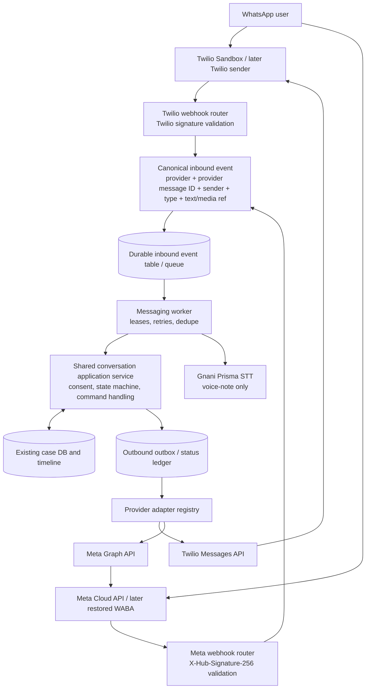

# BolKeResolve WhatsApp Integration — Multi-Provider Architecture & Research Blueprint

**Research date:** 21 October 2026  
**Code source of truth inspected:** `BolKeResolve_WhatsApp_Integration_Improved_2026-10-21.zip`  
**Product context:** BolKeResolve / Gnani AI challenge  
**Decision in this document:** Add a Twilio WhatsApp Sandbox adapter for development while preserving the existing Meta Cloud API adapter and the one shared BolKeResolve case engine.

---

## Executive decision

**Do not rewrite the application and do not create a second chatbot/database.** The existing project already has a substantial WhatsApp workflow. The missing part for Option A is a provider boundary: the application understands Meta's webhook format, message IDs, templates, signatures and Graph API requests directly. Add Twilio as a second transport adapter that converts Twilio webhooks into the same internal message events and calls the same case workflow.

Recommended sequence:

1. Keep the existing case, extraction, resolution, action-pack, timeline and Gnani STT code.
2. Introduce a small provider contract and canonical event types.
3. Keep Meta's current implementation working behind a `MetaCloudAdapter`/compatibility wrapper.
4. Add `TwilioWhatsAppAdapter` for the Trial / Sandbox test channel, including Twilio signature validation, form webhook parsing, outbound REST calls and status callbacks.
5. Add provider-aware contact/message identity so provider message IDs and sender state cannot collide.
6. Move slow inbound work behind a durable queue/outbox boundary. For a small demo, the existing SQLite database can back a leased work table on one durable service; a multi-instance production service should move this queue and application data to shared PostgreSQL/managed queue infrastructure.
7. Start with text and typed commands; add Twilio media/voice-note parity immediately after the text path passes. Keep native Meta buttons when using Meta, and gracefully use text commands with Twilio Sandbox.
8. Leave scheduled reminders disabled for the Twilio Sandbox. It is a testing environment, has restricted template support, and is not a production sender.

### Why this is the right fit

BolKeResolve's differentiator is not the WhatsApp API itself. It is the **voice-first, multilingual, source-backed case-resolution workflow**: capture a person's story, confirm facts, prepare next steps/evidence/drafts, preserve user-reported case history, and continue the same case through another channel. The transport should be replaceable; the case engine should not be.

Twilio's own documentation calls the WhatsApp Sandbox a testing/discovery environment and says not to use it in production. It allows testing inbound replies, webhook configuration and delivery callbacks without requiring your own registered WhatsApp sender. Trial accounts currently list 100 WhatsApp messages as a free unit and expire after 30 days; Twilio's September 2026 price page lists a $0.005 Twilio handling fee per inbound/outbound message plus applicable Meta template fees. So it is a **low-friction temporary development route, not a promise of free production messaging**. [Twilio Sandbox](https://www.twilio.com/docs/whatsapp/sandbox) · [Twilio Trial](https://www.twilio.com/docs/usage/tutorials/how-to-use-your-free-trial-account) · [Twilio pricing](https://www.twilio.com/en-us/whatsapp/pricing).

---

## 1. Scope, method and confidence labels

I inspected the improved ZIP directly, including `backend/main.py`, `backend/whatsapp.py`, the SQLite schema/migrations, the case APIs, the reminder worker, environment example, frontend integration calls and the WhatsApp tests. I also reviewed the included launch guide and architecture notes. I then researched **50+ relevant documentation pages, code repositories and issue reports across more than 20 domains/organisations**, with closer inspection of the most relevant provider docs and example code. The source register at the end records each reference and the pattern it informed.

The sources fall into distinct evidence categories:

- **Official vendor documentation:** best for current API requirements, test-environment limits, billing, webhook signatures, and policy constraints.
- **Official or mature open-source repositories:** useful for code organisation, delivery-state handling, job queues and testing patterns; not automatically production-safe merely because the repo is public.
- **Issue reports:** evidence of real failure modes worth testing for, not proof that every installation has the same defect.
- **Datasets:** potentially useful for offline language evaluation, not a substitute for testing the live Gnani endpoint or the WhatsApp transport.
- **Architecture recommendations below:** design conclusions based on the inspected BolKeResolve code and the cited patterns. They are not claims that the existing code already implements the proposed structure.

### Verified local test result

I reran the current ZIP's tests and static checks in the available environment:

- `python -m unittest discover -s tests -q` — **104 tests passed**.
- `python -m py_compile backend/main.py backend/whatsapp.py scripts/send_whatsapp_reminders.py scripts/check_whatsapp_config.py` — passed.
- `node --check frontend/app.js` — passed.

The suite mocks provider network calls; this does not prove that a Twilio account, Meta account, or Gnani key will work live. This audit is not a live integration test.

---

## 2. Product intention reconstructed from the current project

The included playbook and source code show that the intended WhatsApp product is **a channel for the existing BolKeResolve case engine**, not a second independently managed bot.

The expected user journey is:

1. A user starts from WhatsApp or the website.
2. The user explicitly opts in with `START` before sharing a story.
3. The user explains a payment/consumer issue in natural language, or sends a short supported voice note.
4. The backend redacts likely sensitive text and extracts candidate facts (merchant, amount, date, issue/status).
5. The user can review the summary and choose `SAVE`, `EDIT` or `CANCEL`; a new case is only created after `SAVE`.
6. The user can link a pre-existing web case using a short-lived, single-use `LINK <CODE>` token.
7. The user can check locally stored status, add a user-reported update, mark that support was contacted, set a follow-up, and record whether the issue was resolved.
8. Optional reminders only run for a consenting, linked contact and only when an appropriate approved template is configured.
9. The same case is visible in the website's case workspace and case timeline.

Safety/product boundary: BolKeResolve prepares information and tracks what the user reports. It does not independently query the user's bank, merchant, UPI, NPCI or government systems, and it does not file a complaint on the user's behalf. The adapter must not weaken or obscure that boundary.

---

## 3. Current repository and integration audit

### 3.1 Relevant tree as delivered

```text
BolKeResolve_MVP/
├── backend/
│   ├── main.py             # FastAPI app, DB/schema, auth, cases, timeline,
│   │                       # WhatsApp command state machine + webhook endpoints
│   ├── whatsapp.py         # Meta Graph API helpers, Meta webhook parsing/signature,
│   │                       # encrypted phone storage, fingerprinting, Meta media fetch
│   ├── extraction.py       # candidate facts from the user's story
│   ├── resolution.py      # deterministic issue classification and source-backed plans
│   ├── action_pack.py     # first action, evidence checklist, next-step packet
│   └── security.py        # best-effort detection/redaction of sensitive text
├── frontend/
│   ├── index.html
│   ├── app.js              # progressive intake, chat-style intake, case workspace,
│   │                       # WhatsApp connect/handoff UI, voice actions
│   ├── styles.css
│   ├── design-v2.css
│   └── privacy.html        # draft notice; requires final product-specific review
├── scripts/
│   ├── send_whatsapp_reminders.py  # one-shot Meta-template reminder worker
│   └── check_whatsapp_config.py    # safe configuration preflight; sends no messages
├── tests/
│   ├── test_whatsapp_integration.py
│   ├── test_gnani_integration.py
│   ├── test_resolution.py
│   ├── test_extraction.py
│   ├── test_action_pack.py
│   ├── test_auth.py
│   ├── test_security.py
│   └── test_frontend_assets.py
├── docs/
│   ├── WHATSAPP_LAUNCH_PLAYBOOK.md
│   ├── WHATSAPP_INTEGRATION_GUIDE_2026-10-21.md
│   ├── ADAPTIVE_INTAKE_AND_WHATSAPP.md
│   ├── DEEP_RESEARCH_AND_PRODUCT_BLUEPRINT.md
│   └── other research/milestone notes
├── Dockerfile
├── render.yaml
├── requirements.txt
└── .env.example
```

### 3.2 What is already implemented

| Capability | Current implementation | Assessment |
|---|---|---|
| Meta webhook verification | `GET /api/webhooks/whatsapp`, verify token and challenge | Present; Meta-specific. |
| Meta webhook authenticity | HMAC-SHA256 `X-Hub-Signature-256` over raw request bytes | Present and tested. Must not be reused as Twilio's validator. |
| Inbound parsing | `parse_inbound_messages` handles Meta `text`, button/interactive and audio message shapes | Present; tied to Meta payload. |
| Delivery receipts | `parse_status_updates` handles `sent`, `delivered`, `read`, `failed` | Present; tied to Meta status payload. |
| Outbound text/buttons/templates | Meta Graph API calls in `backend/whatsapp.py` | Present; three different capability types. |
| Consent and opt-out | `START`, `STOP` and additional explicit opt-out phrases | Present in shared command handler. Provider-level keyword processing must be integrated as well. |
| Save gate | Story preview then `SAVE`/`EDIT`/`CANCEL` | Present; important product guardrail. |
| Web case linking | Short-lived, single-use eight-character case code; owner checks | Present. |
| Shared timeline | Updates record actor/channel/source and user-reported status | Present. |
| Audio | Meta media retrieval with host allow-list, 12 MB limit, per-sender quota, Gnani Prisma transcription and saved language preference | Present for Meta; a different downloader/parser is needed for Twilio. |
| Reminder worker | One-shot scheduler, lease, approved Meta template, provider receipts | Present but hard-coded to Meta template semantics. Must remain disabled for Twilio Sandbox initially. |
| Phone privacy | Encryption at rest and keyed fingerprint | Present. Provider-scoped identity must be added for the second adapter. |
| Inbound retry protection | Deduplication and reclaimable processing leases | Present for Meta. Need provider-aware uniqueness and tests for both vendors. |
| Production deploy files | Dockerfile and Render Blueprint with a persistent disk, production auth settings | Present as a starting point. Render comments correctly note the persistent disk requires a paid plan. |

### 3.3 Main seams that are provider-coupled

1. **`backend/whatsapp.py` is Meta-only.** It has Graph API version/config, bearer-token requests, Meta payload parsing, Meta signature verification and Meta media lookup. There is no Twilio adapter yet.
2. **`backend/main.py` contains both the application/domain workflow and transport orchestration.** It owns the command state machine, contact/session/case link logic, inbound Meta webhook, media-to-Gnani orchestration, outgoing reply selection and receipt updates. It is the largest structural coupling point.
3. **`scripts/send_whatsapp_reminders.py` sends Meta template messages directly.** Meta uses `template.name + language + components`; Twilio's Content API uses a `ContentSid` and `ContentVariables`. A generic scheduler should not assume the two template models are interchangeable.
4. **DB table names and identifiers assume one WhatsApp provider.** `whatsapp_contacts`, `whatsapp_sessions`, `whatsapp_case_links`, `whatsapp_webhook_messages`, and `whatsapp_outbound_messages` currently have no explicit provider discriminator. For two providers, persist provider identity rather than relying on a message ID/phone hash being globally unique by accident.
5. **Webhook processing is synchronous today.** The Meta route performs command handling, and for voice notes may download media and call Gnani, then sends the reply before returning. It has recovery logic, but a slow transcription or provider outage can extend webhook latency. A premium multi-provider design should store a verified event durably, respond quickly, and let a worker process it.
6. **UI readiness reflects only `whatsapp_cloud_api_ready`.** `GET /api/config` and `frontend/app.js` assume a Meta Cloud API readiness flag. A provider-aware UI should show which route is configured and whether it is a testing-only route, without exposing secrets.

### 3.4 DB and state already worth preserving

The current schema includes the shared case/timeline tables and these integration-specific tables:

- `whatsapp_contacts`: encrypted number, keyed fingerprint, consent/enabled state and optional owner link.
- `whatsapp_sessions`: state machine (`idle`, `awaiting_story`, `awaiting_confirmation`, etc.), draft story, active case and voice-note language.
- `whatsapp_case_links`: channel contact-to-case links.
- `whatsapp_link_tokens`: hashed one-time tokens with expiry and consumed timestamp.
- `whatsapp_webhook_messages`: inbound dedup/state, reply text, case ID, status, lease, attempts and last error type.
- `whatsapp_outbound_messages`: provider message ID, case, purpose, status, timestamp and error code.
- `reminder_delivery_claims`: prevents concurrent reminder workers from sending the same follow-up twice.

**Do not fork these into a second Twilio database.** Introduce provider columns and migrations or rename them deliberately when adding a generic `messaging_*` schema. The lowest-risk implementation is an additive SQLite migration with existing rows defaulting to `meta`.

---

## 4. What external implementations teach us

Across the source set, the most useful patterns are consistent.

### Pattern A — transport adapter, stable application workflow

Meta's sample repository demonstrates specific payload parsing, message calls and signature verification. Twilio uses a different request contract (form parameters and an `X-Twilio-Signature` check using Twilio's SDK). Rasa's Twilio connector and Botpress's messaging integration docs show the common pattern of adapting external messages into one internal conversation system. The right lesson is **copy the boundary pattern, not a new chatbot framework**.

### Pattern B — validate and persist before acknowledgment; slow work in a worker

The open-source `wa-agents` design has a listener that validates/normalizes/persists webhook events and enqueues newly seen message IDs, then a worker handles conversational state. A smaller FastAPI/SQLite bot demonstrates a “fast lane” (verify → queue → acknowledge) and “slow lane” (process → save → reply). FastAPI itself says its in-process `BackgroundTasks` is for small tasks; heavy/reliable work can need a worker/queue. AWS's transactional outbox guidance explains how to avoid database-write/message-send inconsistency and why consumers must be idempotent. The practical takeaway is not “add Kafka immediately”; it is “make inbound work durable and recoverable.”

### Pattern C — treat status callbacks as asynchronous, possibly out of order

Twilio status callbacks can progress through `queued`, `sent`, `delivered`, `read`, `failed`/`undelivered` depending on channel/provider. Meta sends `sent`, `delivered`, `read`, and `failed`. A 2026 Chatwoot issue reports a real status-downgrade race when a late `sent` event overwrites a previous `delivered` state. BolKeResolve already has a monotonic Meta status guard; keep and generalise this invariant for Twilio. `accepted` is not the same as `delivered`.

### Pattern D — template and capability differences must be explicit

Twilio Sandbox allows only its pre-approved template examples for business-initiated messages; it doesn't support custom templates. It also has a shared sender, requires every test recipient to join, expires sandbox participation after three days, and limits send rate. Therefore the sandbox can verify interactive conversation flow, not final production reminders/template behaviour. In a future production Twilio sender, template IDs and variables need a provider-specific mapping. Keep reminders disabled until this mapping and policy/cost checks are tested.

### Pattern E — webhook signing is not portable across providers

- Meta Cloud API: HMAC SHA-256 over the exact raw body using the Meta App Secret, compared with `X-Hub-Signature-256`.
- Twilio: use `twilio.request_validator.RequestValidator` with the actual public request URL, POST parameters and `X-Twilio-Signature`. Twilio's docs explicitly recommend using its SDK validator because it may add parameters over time.

Do not try to validate both vendors with one homemade signature function. The adapter should own provider-specific authentication and deliver only verified canonical events to the application layer.

### Pattern F — opt-out can be handled by the provider before our bot sees it

Twilio supports a separate opt-in/opt-out system for WhatsApp when Advanced Opt-Out is configured. It can send a confirmation itself and block later outbound sends; its payload can contain `OptOutType`. In the Sandbox, replying `stop` also leaves/disconnects the sender from that sandbox. This creates an important development wrinkle: use `UNSUBSCRIBE` or another supported non-reserved product opt-out phrase to test BolKeResolve's own state machine while joined to the sandbox. For production, parse provider-level opt-out signals, suppress sending, mark the app's contact as opted out and avoid sending a second confirmation if Twilio already sent one.

### Pattern G — official network APIs are preferable to Web-session automation

Libraries such as `whatsapp-web.js` and some Evolution API modes automate WhatsApp Web through unofficial protocol/session mechanisms. Their own repositories disclaim official affiliation and warn that accounts may be blocked. Do not use them to bypass account verification or send production consumer data. They are not a safe answer to the Meta account blocker.

---

## 5. Recommended architecture for BolKeResolve

### 5.1 Target: ports/adapters around the existing case engine



The diagram expresses the target, not the current code. The website continues to call the existing case APIs. The new provider layer must invoke the same conversation application service that today is represented by helpers in `backend/main.py`; it should not recreate `build_resolution`, `extract_case_facts`, `build_action_pack`, ownership rules or case timeline logic.

### 5.2 Keep the first refactor small

Avoid a “microservices rewrite.” Suggested incremental tree:

```text
backend/
├── main.py                         # existing FastAPI shell and web/case routes
├── extraction.py                   # keep existing
├── resolution.py                   # keep existing
├── action_pack.py                  # keep existing
├── security.py                     # keep existing
├── whatsapp.py                     # retain Meta wrappers temporarily; migrate gradually
└── messaging/
    ├── __init__.py
    ├── contracts.py                # InboundMessage, DeliveryEvent, SendResult, capabilities
    ├── identity.py                 # provider-aware sender fingerprint + encrypted phone
    ├── application.py              # extracted shared START/SAVE/STATUS/UPDATE state machine
    ├── service.py                  # provider registry, inbound dispatch, outbound send routing
    ├── persistence.py              # inbound dedupe/leases, contact/session/outbound status helpers
    ├── outbox.py                   # durable queue/claim helpers
    ├── webhooks/
    │   ├── meta.py                 # GET verify + signed Meta POST
    │   └── twilio.py               # signed form POST + status callback
    └── providers/
        ├── base.py                 # Protocol/abstract contract
        ├── meta_cloud.py           # wraps existing Meta functions first
        └── twilio.py               # Twilio Sandbox/Programmable Messaging API
scripts/
├── send_whatsapp_reminders.py      # keep only after provider-aware template dispatch
├── check_whatsapp_config.py        # extend to show provider readiness without secrets
└── run_messaging_worker.py         # long-running/polling worker for queued jobs

tests/
├── test_whatsapp_integration.py    # preserve existing regression tests
├── test_messaging_contracts.py
├── test_twilio_webhook.py
├── test_provider_parity.py
└── test_delivery_state_machine.py
```

This is a destination tree. We should not move every helper on day one. First add the contracts and Twilio adapter beside existing files; extract the state machine only after we can call it via both providers and have regression coverage.

### 5.3 Canonical contract

Both providers should convert their payloads to the same internal shape. Use Pydantic models or frozen dataclasses; reject malformed required fields early.

```python
class InboundMessage:
    provider: Literal["meta", "twilio"]
    provider_message_id: str
    sender_e164: str
    recipient_id: str                 # Meta phone_number_id or Twilio To address
    message_type: Literal["text", "interactive", "audio", "image", "document", "other"]
    text: str
    media_id: str | None
    media_url: str | None             # avoid persisting raw URLs if they contain credentials
    media_mime_type: str | None
    received_at: datetime | None

class DeliveryEvent:
    provider: Literal["meta", "twilio"]
    provider_message_id: str
    status: Literal["accepted", "queued", "sent", "delivered", "read", "failed", "undelivered"]
    event_timestamp: datetime | None
    error_code: str | None

class SendResult:
    provider: Literal["meta", "twilio"]
    provider_message_id: str
    accepted: bool
    provider_status: str | None
```

The real implementation should validate, cap string lengths and normalise telephone addresses to the internal digits-only representation. Keep the original provider address (`whatsapp:+...` for Twilio) only where needed to address that provider's API. Never store an entire raw webhook body unless there is a reviewed, encrypted, short-retention diagnostic reason.

Provider contract should offer operations such as:

- `verify_inbound_request(request_context) -> bool` (implementation differs per provider)
- `parse_inbound(form_or_json) -> list[InboundMessage]`
- `parse_status_callback(...) -> list[DeliveryEvent]`
- `send_text(to, body, context) -> SendResult`
- `send_guided_reply(...)` with capability-aware fallbacks
- `send_template(template_ref, variables, ...)` (provider-specific template mapping)
- `download_audio(media_ref)` where media types are supported and securely validated
- `capabilities` describing text, buttons, lists, template and media support.

Don't make “provider abstraction” an excuse to flatten genuine differences. Let Meta use native interactive buttons while Twilio Sandbox emits plain text commands. A useful fallback is better than emulating an unsupported button type or silently dropping the action.

### 5.4 Endpoint plan

Keep the current Meta route working while adding explicit provider paths:

```text
GET  /api/webhooks/whatsapp/meta          # Meta verification
POST /api/webhooks/whatsapp/meta          # Meta signed events
POST /api/webhooks/whatsapp/twilio        # Twilio inbound messages; form-encoded
POST /api/webhooks/whatsapp/twilio/status # Twilio message status callback
```

Retain `GET/POST /api/webhooks/whatsapp` as a compatibility alias for Meta until current deployments/docs are migrated. Do not point the same callback URL at both providers.

For Twilio:

- Parse the request as form-urlencoded fields (FastAPI already depends on `python-multipart`).
- Verify `X-Twilio-Signature` using `RequestValidator` and the **externally visible HTTPS URL**. Behind Render/a reverse proxy, use explicit environment-configured public callback URLs so `http://internal-host/...` is not compared to the URL Twilio signed.
- Validate the expected `AccountSid`, `To` sender address and provider configuration. A valid signature alone should not route a message from an unexpected configured account/sender into the wrong environment.
- Inbound message IDs use `MessageSid`; inbound phone addresses arrive in `From`/`To` with a `whatsapp:` prefix. Status callbacks use provider-specific fields such as `MessageSid`, `MessageStatus`/`SmsStatus` and `ErrorCode`.
- A Twilio inbound endpoint should return an appropriate minimal TwiML response quickly. Because the application will send its own REST API reply from a worker, the inbound response can be an empty `<Response/>` rather than performing Gnani transcription and outbound calls before responding.

### 5.5 Contact identity and schema evolution

The simplest safe migration is additive and keeps current data:

- Add `provider TEXT NOT NULL DEFAULT 'meta'` to existing contact/session/outbound records where required.
- Preserve the current Meta fingerprint computation for existing rows to avoid breaking `source_contact_hash`/case-link references.
- For new provider rows, fingerprint a provider-namespaced value (conceptually `HMAC(key, provider + ":" + normalized_sender)`) so the same phone can have independent Meta and Twilio consent/session state.
- Add provider identity to dedup/status records. For inbound messages, the uniqueness contract should be `(provider, provider_message_id)`, not `provider_message_id` alone. The same rule is preferable for outbound records.
- Add a configured sender/account identifier when multiple senders become possible; `provider='twilio'` alone is not sufficient for a future multi-account service.
- Continue to use one `cases` table and one case timeline. A `LINK <CODE>` sent from Twilio should link that provider-specific contact to an existing web case via the same one-time token flow.
- Add a provider column to contact links or guarantee that the `phone_hash` is provider-specific. The latter can preserve the current join pattern in the short term.
- Add a `provider` and `provider_message_id` field to outgoing tracking (or perform a controlled table rebuild). Record status using a composite provider/message key.

Migration tests must prove existing Meta contacts, encrypted phone values, active sessions, consumed/unconsumed link tokens, outbound receipts and scheduled follow-ups are unchanged after upgrade/downgrade handling. Do not replace or rotate `WHATSAPP_PHONE_ENCRYPTION_KEY` casually; it is needed to decrypt existing contact records.

### 5.6 Durable processing and exactly-once caveat

Current Meta handling already uses a lease/retry record to recover messages left in `processing` and to reuse a saved reply when API sending fails. Retain that behavior. Add provider identity to the same idempotency rules.

The next iteration should split the request into two lanes:

1. **Fast ingress lane:** verify signature → parse/normalise → insert idempotency row/event in a database transaction → return provider acknowledgment.
2. **Worker lane:** claim row with lease → transcribe only if required → run shared command handler in one transaction → persist reply/outbox → send via selected adapter → store provider ID and status.

Use an SQLite-backed queue/outbox for a single durable instance and the small challenge demo if it meets operational constraints. Do not use a process-local in-memory queue as the sole durability layer; a restart would lose queued work. `FastAPI.BackgroundTasks` can be acceptable for trivial work, but not a reliable substitute for a persisted job queue. Later, move to shared PostgreSQL plus Supabase Queues/PGMQ, Redis/RQ, Celery, Dramatiq, or another managed queue only when deployment scale or multi-worker requirements justify it.

**Exactly-once external send is not guaranteed.** If the provider accepts a reply and the process crashes before storing the provider ID, a retry may send the same reply again. Build at-least-once processing with internal idempotency and clear uncertain-send states; don't promise mathematical exactly-once delivery unless the external API provides a usable idempotency key for that operation.

### 5.7 Delivery-state normalisation

Map provider-specific receipt values to a common ordered model:

```text
created/accepted < queued < sent < delivered < read
                                ↘ failed / undelivered (terminal failure)
```

Define explicit terminal-state rules rather than using timestamp arrival order alone. Ignore late callbacks that attempt to move a successful status backwards. Record error code, provider, message ID and timestamp; avoid logging message body, phone, token or media URL. A provider API response is “accepted”/“queued”, not “delivered”. `read` may not be available if the recipient disables read receipts.

Current Meta receipt handling already has a monotonicity guard. Extend the tests to Twilio and to out-of-order callback sequences. If statuses contradict each other, keep both events in an audit trail while exposing the most conservative/valid current state.

### 5.8 Voice-note and media parity

Preserve the Gnani integration. The adapter boundary should provide a provider-specific secure media download and then call the existing shared transcription function.

For Twilio incoming media:

- Parse the media URL/content type, but do not trust it as arbitrary fetch input.
- Require HTTPS, allow-list expected Twilio media hostnames, and use appropriate Twilio authentication for protected media resources.
- Cap the download at the app's current 12 MB limit, check supported audio MIME types and duration, and enforce the same per-sender quota before making a paid Gnani call.
- Store a media SID/reference instead of a raw URL with embedded access material wherever possible; never log signed URLs.
- On unsupported/non-audio media, explain that evidence can be added on the website case page. Preserve the current stated limitation that image/document ingestion is not yet a full cross-channel feature.

The quickest milestone can begin with text only, but the acceptance criterion for “feature parity with the current product intent” must include voice note → Gnani transcription → review/confirmation → shared case.

### 5.9 Templates and reminder semantics

A template is not a portable string. Meta expects a template name/language/components, while Twilio's Content API expects a provider-specific `ContentSid` and `ContentVariables`. Twilio Sandbox cannot use custom templates. Therefore:

- Keep the current Meta template path unchanged behind Meta adapter.
- Add Twilio text replies inside user-initiated service windows first.
- Disable `send_whatsapp_reminders.py` for provider `twilio_sandbox`, with an explicit “unsupported in sandbox” reason rather than a failed send loop.
- For a later Twilio production sender, store the Twilio `ContentSid`, approved locale, variables and approval state separately from Meta's template name/language.
- Before a reminder is sent, check consent, contact link, follow-up due state, provider-supported template, customer-service window/template rule and rate/cost budget.

---

## 6. Twilio Sandbox option: conditions, credentials and realistic limits

### What it gives us

- A shared test WhatsApp sender managed by Twilio.
- A test experience without first registering our own WhatsApp production sender or supplying our own WABA business-verification documents for that sender.
- Inbound messages and outbound replies, an inbound webhook URL and message-status callbacks.
- API calls through Twilio's `Messages` resource. For WhatsApp, the `From`/`To` values use `whatsapp:+E164` format.

### Sandbox limits we must design around

- It is **for development/testing only**, not for real customers or public production traffic.
- Every tester must join the specific sandbox using `join <sandbox code>` (or the displayed QR). Participation expires after three days and may need rejoining.
- It is a shared sender and only joined recipients can receive messages.
- The Sandbox has a send rate limit (the current docs say one message every three seconds).
- Business-initiated messages are restricted to Twilio's pre-approved Sandbox templates; custom templates require a registered sender.
- The Trial flow limits sending to verified recipients; account/trial rules and sender availability may vary by the account's Console path.
- Current trial materials list 100 WhatsApp message free units for up to a 30-day trial. Check the Console's Free units tracker. After the allowance, standard pricing applies. Current Twilio pricing page (September 2026) lists $0.005 per inbound/outbound Twilio message plus applicable Meta template charges.
- Test the app's own opt-out state using `UNSUBSCRIBE` or a non-reserved phrase while joined. Sending `stop` can disconnect the user from the sandbox/provider messaging service rather than merely exercising our own handler.

### Server environment variables to add for Option A

The exact final names can be standardised during implementation; recommended names are:

```dotenv
# Provider selection and safe mode
WHATSAPP_DEFAULT_PROVIDER=twilio
WHATSAPP_TWILIO_MODE=sandbox

# Twilio credentials: never expose in browser JavaScript or commit to Git
TWILIO_ACCOUNT_SID=
TWILIO_AUTH_TOKEN=
TWILIO_WHATSAPP_FROM=whatsapp:+14155238886

# The public externally visible callback URL (important behind a reverse proxy)
TWILIO_WEBHOOK_PUBLIC_URL=https://YOUR_PUBLIC_HOST/api/webhooks/whatsapp/twilio
TWILIO_STATUS_CALLBACK_URL=https://YOUR_PUBLIC_HOST/api/webhooks/whatsapp/twilio/status

# Meta settings remain available and unchanged for later production use
WHATSAPP_ACCESS_TOKEN=
WHATSAPP_PHONE_NUMBER_ID=
WHATSAPP_APP_SECRET=
WHATSAPP_VERIFY_TOKEN=
WHATSAPP_PHONE_ENCRYPTION_KEY=
```

Do not paste credentials in chat/screenshots. The Twilio **Auth Token** has equivalent sensitivity to a provider password. In the configuration preflight, print only whether a secret exists and which provider is selected, never its value.

---

## 7. Detailed comparison of paths

| Path | Can start without our Meta WABA working? | Automated two-way bot? | Production suitable by itself? | Cost picture | Recommended role |
|---|---:|---:|---:|---|---|
| Twilio WhatsApp Sandbox | Yes, for testing through Twilio's own test setup | Yes for supported sandbox interactions | **No**; sandbox docs prohibit production use | Trial free-unit allowance, then Twilio per-message fee plus applicable Meta template charges | Option A: prove provider adapter and user journey now |
| Existing direct Meta Cloud API | No while this WABA is blocked | Yes | Yes, when account, sender, subscription and compliance gates are satisfied | No BSP subscription; Meta messaging and hosting/provider costs may still apply | Preferred low-cost long-term route if Meta restriction clears |
| WhatsApp click-to-chat (`wa.me`) | Yes | No inbound bot automation; user manually sends prefilled text | Suitable as a manual handoff, not a bot integration | No API subscription; normal WhatsApp usage | Always-available fallback from the web case workspace |
| WhatsApp Business App | Separate manual business workflow | Limited canned greetings/away/quick replies; not equivalent to backend integration | For human-led small-scale support | App free; human-operated workflow | Early human support, not case automation |
| Gupshup sandbox/managed API | May offer a separate dev path; confirm onboarding and account requirements | Yes depending on the offered sandbox/product | Registered sender/production onboarding required | Plan/wallet/provider and Meta charges vary | Secondary provider candidate if Twilio's sandbox is unsuitable |
| Chatwoot | Requires a valid supported WhatsApp API connection or a legitimate managed route | It is primarily a support inbox/agent console | Useful as a human-agent layer after channel is onboarded | Self-hosting/cloud plan plus underlying channel costs | Consider later for human handoff, not a workaround for WABA restrictions |
| Botpress / n8n | Depends on selected WhatsApp integration and provider credentials | Yes for its own workflows | Not automatically a bypass of Meta onboarding | Free tiers/hosted plans and underlying API charges vary | Good for automation prototypes, but creates another workflow system; not first choice for our core app |
| Unofficial Web-session libraries | May appear easy to start | Often extensive functionality | **Not recommended**; may violate WhatsApp terms/lead to block, weaker supportability | Self-host cost hides account/compliance risk | Do not use for production or the contest demo |

**Provider decision:** Twilio Sandbox is the best near-term way to validate the two-way transport, because it avoids depending on our currently blocked Meta WABA. Direct Meta remains the target production route if the account restrictions can be resolved. Do not add Chatwoot/Botpress/n8n unless the project has a specific human-inbox/orchestration need; BolKeResolve already has a case engine that should remain the source of truth.

---

## 8. Implementation plan: safe sequence with acceptance gates

### Phase 0 — freeze a known-good baseline

- Branch/archive the current improved ZIP and record its SHA-256 checksum.
- Run all 104 tests and static checks before modifications.
- Do not mix the Meta account-unblock investigation with code refactoring.
- Do not attempt production reminders or public customer onboarding during the Twilio Sandbox phase.

**Gate:** baseline tests pass; one case can still be created on the website; Meta route's current tests pass unchanged.

### Phase 1 — add provider contracts and Twilio text path

1. Add `contracts.py` and `base.py` with canonical inbound, status and send-result models.
2. Wrap current Meta functions in `MetaCloudAdapter` (or keep `backend/whatsapp.py` as its initial implementation). No behavior changes to Meta at first.
3. Add `TwilioWhatsAppAdapter` using `TWILIO_ACCOUNT_SID`, `TWILIO_AUTH_TOKEN`, `TWILIO_WHATSAPP_FROM` and Twilio's message endpoint/official SDK.
4. Add `/api/webhooks/whatsapp/twilio` route. Validate `X-Twilio-Signature` with Twilio's SDK using the public callback URL and form params. Reject invalid signatures; never process unsigned requests.
5. Convert `MessageSid`, `From`, `To`, `Body`, media fields and timestamp into a canonical inbound event.
6. Invoke the *same* consent/command/case handler. Twilio Sandbox gets text-only guided replies; Meta keeps native interactive buttons.
7. Add provider-aware config status to `/api/config` without exposing secrets. Add clear labels in the UI: “Twilio sandbox testing” versus “official production WhatsApp”.

**Gate:** with a joined test phone and public HTTPS callback, sending `START`, a simple story, `SAVE`, `STATUS` and `UPDATE` goes through Twilio to the same case database; the web UI shows the case; provider test signatures work; invalid signatures are rejected. Do not declare “delivered” on API acceptance alone.

### Phase 2 — provider-aware persistence and status callback

- Add the `provider` discriminator to contact/outbound/inbound state with backward-compatible default `meta`.
- Use provider-namespaced sender fingerprints for new providers while preserving current Meta fingerprints for existing records.
- Make inbound/outbound message identity unique by `(provider, provider_message_id)`.
- Add `/api/webhooks/whatsapp/twilio/status` and normalize Twilio statuses to the common delivery state model.
- Ensure out-of-order `sent` doesn't overwrite `delivered`, and don't update a case from an unknown provider message ID.
- Keep provider error codes and IDs in structured metadata; never log secrets/phone numbers/body.

**Gate:** status callback tests cover queued → sent → delivered → read, failed/undelivered, repeated status, out-of-order receipt, unknown ID, and provider ID collision scenarios.

### Phase 3 — durable ingress/outbox and retries

- Add a DB-backed inbound event/job table and an outbound outbox (or evolve the current `whatsapp_webhook_messages` state machine with provider-aware keys) that commits before returning a webhook acknowledgment.
- Return a fast provider-specific acknowledgment after validation and persistence; do not await Gnani transcription or provider sends inside the ingress request.
- Implement lease expiry/reclaim, bounded attempts, exponential backoff for transient errors, explicit terminal failure state, and a dead-letter/diagnostic view or command.
- Worker claims a job atomically, applies command/session changes once, persists the reply, sends via adapter, then persists provider ID/status.
- Mark the outcome `uncertain` if an outbound request times out after submission and no provider message ID can be recovered; avoid blind unbounded retries.
- For a single small demo, SQLite queue + one worker on a durable disk is a pragmatic interim. For production multi-worker/multi-instance scaling, use shared PostgreSQL/managed queue with tested backup/restore.

**Gate:** simulated process crash at every boundary (after inbox insert, after case transaction, after send accepted, before status persisted) does not silently lose the message/case, and does not apply the same case command twice. Document the one unavoidable duplicate-send uncertainty if the provider accepts but the client loses the response.

### Phase 4 — audio feature parity

- Parse Twilio media fields and audio MIME types.
- Securely fetch only valid Twilio media URLs/resources, enforce size/content-type/duration limit and quota.
- Feed the bytes to the existing Gnani transcription path and reuse language preference handling.
- Keep images/documents in the current “upload after case creation on website” flow until dedicated safe evidence ingestion is implemented.

**Gate:** sample Hindi, Hinglish and English voice notes work in the sandbox; malformed, oversized, unsupported, expired and malicious media URLs are rejected; Gnani failures return a useful text fallback; no duplicate paid STT call on message retry.

### Phase 5 — consent, template, and operational hardening

- Reconcile Twilio `OptOutType`/provider block state with BolKeResolve's own `enabled` field.
- Test `START`, `STOP`/`UNSUBSCRIBE`, re-opt-in, expired case link, one-time link replay, owner mismatch and link-after-opt-out.
- Ensure a provider-specific opt-out confirmation is not double-sent if the provider has already sent it.
- Keep reminder worker disabled for Sandbox. Production template integration is a separate subproject requiring approved templates, consent proof, rate/cost controls and timezone tests.
- Add monitoring for webhook 4xx/5xx, signature failures, queue age/retries, Gnani errors/usage, send/status failures and backup/restore outcome.
- Finalise accurate public privacy notice, support contact, retention/deletion process, data processor review and incident response. The bundled privacy page is a draft, not legal sign-off.

**Gate:** security/privacy review and real-device mobile/accessibility review complete before production data is accepted.

---

## 9. Test matrix needed for a premium implementation

| Area | Test cases | Success condition |
|---|---|---|
| Provider signature | valid Twilio signature; missing/invalid signature; wrong callback URL; URL behind proxy; altered form field | Valid events proceed; every invalid signature returns 401/403 and never mutates a case. |
| Idempotency | same inbound ID repeated; same event with different provider ID; simultaneous duplicate deliveries | Exactly one logical case command runs; response replay is safe. |
| Shared case behavior | new story preview, SAVE, EDIT, CANCEL, STATUS, UPDATE, FOLLOWUP, RESOLVED, NEW, HELP | Same backend result and timeline semantics via Twilio and Meta. |
| Provider parity/fallback | Meta buttons vs Twilio text replies; unsupported interactive content; long message | No action is lost; text command fallback is explicit and user-comprehensible. |
| Consent/privacy | START, STOP, UNSUBSCRIBE, provider OptOutType, re-opt-in, link before consent, link after opt-out | No message/story processing before active opt-in; stop state suppresses future sends. |
| Link security | valid, expired, consumed, malformed, owner mismatch, code guessed/replayed | Single-use, expiring token; no case leaks across users. |
| Delivery states | accepted vs queued vs sent vs delivered vs read vs failed/undelivered, out of order | Current state never moves backward; API acceptance is not called delivery. |
| Media/Gnani | valid audio; wrong MIME; oversized; timeout; unsupported locale; quota exhausted; retries | No SSRF; no runaway spend; helpful fallback and no duplicate case action. |
| Reminder/template | no template, sandbox mode, contact opted out, unlinked case, due/future/completed date, worker overlap | Sandbox reminders remain disabled; production reminder gating is idempotent. |
| Persistence/recovery | restart during queue; database busy; stale lease; worker crash; backup restore | Queued items recover; cases remain durable; recovery procedure is documented and tested. |
| UX and accessibility | Android WhatsApp, iPhone, low bandwidth, long Hinglish story, voice note, screen reader/keyboard in web UI | Clear confirmation, error recovery and no unsupported promises. |

### Suggested evaluation dataset

Use 30–50 **synthetic, consent-free test scenarios**, not real financial transcripts, across refund pending, failed UPI, duplicate charge, wrong amount, undelivered order, unauthorised transaction and “unclear/ambiguous”. Include Hindi, Hinglish/code-switching, English and at least two regional languages supported by the current Gnani configuration. Label the correct issue, amount/date (or missing/conflicting), expected first action/source and unsafe details that must be redacted.

Measure: transcript character/word error rate where reference text is available; issue classification accuracy; amount/date extraction accuracy; rate of uncertain facts properly asking for confirmation; correct source-backed guidance; duplicate-case count; inbound-to-reply latency; provider delivery failure; cost per completed test conversation. Target **zero unsupported claims** that a bank/merchant was checked or a complaint was submitted.

For public corpora, Hugging Face has code-switching/Hinglish ASR datasets, including [MUCS Hinglish](https://huggingface.co/datasets/dianavdavidson/MUCS-Hinglish) and a [noisy Hinglish ASR corpus](https://huggingface.co/datasets/addyo07/noisy-hinglish-asr). These are research candidates only: check license, provenance, split leakage and relevance before using. They do not directly represent BolKeResolve's financial vocabulary. Kaggle did not produce a more authoritative production webhook architecture source than the official docs and open-source repositories inspected here, so it should be considered mainly for evaluation data, not transport design.

---

## 10. Security, privacy and operational notes specific to this product

1. **No unofficial WhatsApp Web clients.** Do not work around Meta's lock using QR-session libraries or reverse-engineered clients.
2. **Separate provider secrets.** `TWILIO_AUTH_TOKEN` and `WHATSAPP_ACCESS_TOKEN`/`WHATSAPP_APP_SECRET` are different secrets; rotate any token accidentally shown in a screenshot. Keep all server side.
3. **Webhook routes are public but signature-protected.** Auth middleware must explicitly treat both provider webhook paths as provider-authenticated public endpoints; do not require a browser login cookie and do not exempt them from webhook signature checks.
4. **Use provider-specific signature checks.** Twilio validation uses the externally-visible signed URL and form params; Meta HMAC uses raw body bytes. Reverse-proxy URL mismatch is a common source of signature failures.
5. **Protect media fetches from SSRF.** Never fetch arbitrary `MediaUrl` from an untrusted body; allow-list provider hosts, force HTTPS, set timeouts, reject redirects to disallowed hosts and bound downloads.
6. **Limit data retention.** Avoid storing raw provider payloads, media URLs, or full transcripts in logs. Provide case/contact unlinking and deletion. Keep only status metadata necessary for the case timeline and troubleshooting.
7. **Consent is separate from technical sandbox enrollment.** Joining Twilio Sandbox means the user can exchange messages with the testing sender; it does not itself constitute BolKeResolve's informed product opt-in. The application should still require `START` and show a clear privacy/support/safety message.
8. **Use human escalation.** BolKeResolve deals with consumer payment issues. The UI and WhatsApp bot should say how to reach a monitored support contact and what to do if the situation is urgent/unauthorised. Do not pretend the bot replaces a bank or regulator.
9. **Data protection review.** The current public notice is a draft. The India DPDP Rules and commencement materials are published by MeitY, with staged commencement; review the current timeline and whether the project is handling real user data before live pilot. This report is an engineering recommendation, not legal advice.
10. **Durable storage.** The included Render Blueprint is intentionally configured with a persistent disk and a paid `starter` web service; its comments warn not to use an ephemeral free filesystem for real cases. A separate worker must share the same durable database or use a central database/queue; two instances with separate SQLite files will diverge.
11. **Observability without sensitive logs.** Track provider, message ID (or a safe truncated hash), event type, processing latency, error class/code, attempt count and current state. Redact recipient phone, user story, access tokens and media URLs.

---

## 11. Source register: 50+ pages/repositories reviewed

The items below are not equal authority. Official docs are used for provider behaviour and limits; repositories/issue reports inform implementation patterns and edge-case tests. Repositories should be inspected for licence and maintenance status before code reuse. This project should borrow architecture ideas, not copy substantial code blindly.

### A. Twilio official docs and SDK (provider contract, sandbox, price, security)

1. [Twilio — WhatsApp Sandbox](https://www.twilio.com/docs/whatsapp/sandbox) — test-only limits, shared sender, join codes, 3-day rejoin, template and callback rules.
2. [Twilio — WhatsApp Quickstart](https://www.twilio.com/docs/whatsapp/quickstart) — setup path, test message, `From`/`To` channel addressing and webhooks.
3. [Twilio — WhatsApp API overview](https://www.twilio.com/docs/whatsapp/api) — inbound message parameter shape and supported media concepts.
4. [Twilio — incoming webhook request parameters](https://www.twilio.com/docs/messaging/guides/webhook-request) — `MessageSid`, `From`, `To`, `Body`, media params; expect the parameter set to evolve.
5. [Twilio — validate incoming requests](https://www.twilio.com/docs/usage/tutorials/how-to-secure-your-flask-app-by-validating-incoming-twilio-requests) — use `RequestValidator` and `X-Twilio-Signature` rather than homemade validation.
6. [Twilio Python SDK — RequestValidator source](https://github.com/twilio/twilio-python/blob/main/twilio/request_validator.py) — confirms SDK signature behavior and URL/parameter validation.
7. [Twilio Python SDK repository](https://github.com/twilio/twilio-python) — message client, SDK API and async client support.
8. [Twilio — outbound message status callbacks](https://www.twilio.com/docs/messaging/guides/outbound-message-status-in-status-callbacks) — queued/sent/delivered/read/failed/undelivered model.
9. [Twilio — WhatsApp Content API template quickstart](https://www.twilio.com/docs/content/create-and-send-your-first-content-api-template) — `ContentSid` and `ContentVariables`; provider template identifiers differ from Meta's.
10. [Twilio — send/receive WhatsApp media in Python](https://www.twilio.com/docs/whatsapp/tutorial/send-and-receive-media-messages-whatsapp-python) — separate incoming-media handling and API media resource pattern.
11. [Twilio — free-trial account](https://www.twilio.com/docs/usage/tutorials/how-to-use-your-free-trial-account) — current trial units and 30-day expiry.
12. [Twilio — trial WhatsApp flow](https://www.twilio.com/docs/usage/trials/try-out-whatsapp) — verified recipient limit and Console-specific trial setup.
13. [Twilio — WhatsApp pricing](https://www.twilio.com/en-us/whatsapp/pricing) — September 2026 published $0.005 handling fee per message plus Meta fees.
14. [Twilio — Advanced Opt-Out](https://www.twilio.com/docs/messaging/tutorials/advanced-opt-out) — standard STOP/START/HELP keywords, provider-level block list and `OptOutType`.
15. [Twilio Help — Advanced Opt-Out for Messaging Services](https://help.twilio.com/articles/360034798533-Getting-Started-with-Advanced-Opt-Out-for-Messaging-Services) — how provider opt-out may affect WhatsApp senders.
16. [Twilio Help — WhatsApp messaging best practices](https://help.twilio.com/articles/360017773294-Rules-and-Best-Practices-for-WhatsApp-Messaging-on-Twilio) — WhatsApp limits and policy-aware messaging.
17. [Twilio Sandbox error 63015](https://www.twilio.com/docs/api/errors/63015) — only joined sandbox participants can receive messages, and the three-day join period matters.
18. [TwilioDevEd — WhatsApp media tutorial for Flask](https://github.com/TwilioDevEd/whatsapp-media-tutorial-flask) — simple webhook/media example; repository is archived, so useful as learning material, not a maintenance dependency.
19. [Twilio — WhatsApp templates tutorial](https://www.twilio.com/docs/whatsapp/tutorial/send-whatsapp-notification-messages-templates) — template approval and business-initiated messaging.
20. [Twilio — WhatsApp getting-started Help Center](https://help.twilio.com/articles/360007721954) — legacy Sandbox context and onboarding terminology.

### B. Meta / WhatsApp official docs and examples (keep production path intact)

21. [Meta — WhatsApp Cloud API overview](https://developers.facebook.com/docs/whatsapp/cloud-api/overview) — direct production API concept and setup.
22. [Meta — Cloud API pricing](https://developers.facebook.com/docs/whatsapp/pricing) — current official rate card should override third-party explainers.
23. [Meta — Cloud API webhooks](https://developers.facebook.com/docs/whatsapp/cloud-api/webhooks) — callback verification and webhook configuration.
24. [Meta — WhatsApp Cloud API example repository](https://github.com/fbsamples/whatsapp-api-examples) — examples for templates, basic webhook, media and signature verification.
25. [Meta sample — webhook signature verification](https://github.com/fbsamples/whatsapp-api-examples/tree/main/signature-validation-with-webhooks-payloads) — validates raw body with `X-Hub-Signature-256`.
26. [WhatsApp Business Platform terms](https://www.whatsapp.com/legal/WhatsApp-Terms-for-WhatsApp-Business-Platform?lang=fil) — the published terms note changes effective 23 September 2026; check applicable live locale/terms before production.
27. [Meta Terms for WhatsApp Business](https://www.whatsapp.com/legal/meta-terms-whatsapp-business) — account and business obligations.
28. [WhatsApp Business Policy](https://business.whatsapp.com/policy) — consent, templates, automation and escalation obligations; confirm current policy before launch.

### C. Mature integrations/frameworks (useful boundaries and UX/workflow patterns)

29. [Chatwoot — manual WhatsApp Cloud API setup](https://www.chatwoot.com/hc/user-guide/articles/1756799850-how-to-setup-a-whats_app-channel-manual-flow) — onboarding checklist for app, WABA/phone IDs, permanent token, callback and subscription.
30. [Chatwoot — WhatsApp user guide](https://www.chatwoot.com/hc/user-guide/en/categories/whatsapp) — operator-inbox flow and support-channel context.
31. [Chatwoot GitHub issue — status downgrade race](https://github.com/chatwoot/chatwoot/issues/14529) — practical evidence for monotonic receipt status tests.
32. [Chatwoot GitHub issue — incoming messages not appearing](https://github.com/chatwoot/chatwoot/issues/15131) — shows why HTTP 200/webhook verification isn't proof that downstream jobs are processing.
33. [Botpress — WhatsApp setup](https://botpress.com/docs/integrations/integration-guides/whatsapp/introduction/) — required Meta setup, webhook subscriptions and support escalation limits.
34. [Botpress — messaging integrations architecture](https://botpress.com/docs/integrations/sdk/integration/messaging/) — transport → integration → runtime → bot routing pattern.
35. [Botpress — start conversation through webhook](https://botpress.com/docs/integrations/integration-guides/whatsapp/start-conversation-through-webhook/) — outbound templated initiation via an external event.
36. [Botpress — WhatsApp to Botpress mapping](https://botpress.com/docs/integrations/integration-guides/whatsapp/mapping/whatsapp-to-botpress/) — mapping different native inbound types to a canonical message model.
37. [Botpress — Botpress to WhatsApp mapping](https://botpress.com/docs/integrations/integration-guides/whatsapp/mapping/botpress-to-whatsapp/) — output capability mapping and supported message types.
38. [Rasa — Twilio connector](https://github.com/RasaHQ/rasa/blob/3.6.x/docs/docs/connectors/twilio.mdx) — provider credentials and channel connector route.
39. [n8n — WhatsApp Business Cloud node](https://docs.n8n.io/integrations/builtin/app-nodes/n8n-nodes-base.whatsapp) — explicit send/template/media operations.
40. [n8n — WhatsApp Trigger](https://github.com/n8n-io/n8n-docs/blob/main/docs/integrations/builtin/trigger-nodes/n8n-nodes-base.whatsapptrigger.md) — explicit app subscription prerequisites for inbound events.

### D. Open-source code examples and reliability patterns

41. [wa-agents — Python WhatsApp backend toolkit](https://github.com/luis-i-reyes-castro/wa-agents) — listener/worker separation, persisted normalization, idempotent ingest, routing and context storage.
42. [Helban — customer-support AI bot](https://github.com/Helban/customer-support-ai-bot) — fast webhook ack + queued work pattern; educational example, not a drop-in dependency.
43. [DominiquePaul — Python WhatsApp Cloud API snippets](https://github.com/DominiquePaul/python-whatsapp) — FastAPI/httpx examples for text, interactive messages and voice/media.
44. [HeiCg — async WhatsApp Cloud API Python SDK](https://github.com/HeiCg/whatsapp-cloud-api-py) — typed webhook event parsing and handlers; evaluate maintenance/licence before depending on it.
45. [Atendia — Meta webhook template](https://github.com/atendiatec/whatsapp-meta-webhook-template) — typed payloads, signature middleware, statuses and Docker structure; check its licence and project maturity before reuse.
46. [Typebot WhatsApp client example](https://github.com/Luisotee/typebot-client-whatsapp) — illustrates why middleware can separate WhatsApp transport from bot workflow, but mixes official and unofficial methods; use only the official API path.
47. [whatsapp-web.js repository](https://github.com/wwebjs/whatsapp-web.js) — its own disclaimer says it is unofficial and accounts can be blocked; do not use as a production workaround.
48. [Evolution API repository](https://github.com/EvolutionAPI/evolution-api) — supports official Cloud API and unofficial Baileys-based modes; select only a clearly official, compliant route if evaluating it.
49. [Twilio status callback code examples](https://www.twilio.com/docs/messaging/guides/outbound-message-status-in-status-callbacks) — status callbacks are asynchronous; never conflate create response with final delivery.
50. [Twilio SDK basic usage example](https://github.com/twilio/twilio-python/blob/main/examples/basic_usage.py) — verified message API call shape and environment-based credentials.

### E. Queues, retries, web framework and deployment patterns

51. [FastAPI — Background Tasks caveat](https://fastapi.tiangolo.com/tutorial/background-tasks/) — in-process background tasks are not a durable queue for heavy/reliable work.
52. [FastAPI — form data](https://fastapi.tiangolo.com/tutorial/request-forms/) — Twilio webhook parsing requires form-urlencoded handling and `python-multipart` support.
53. [AWS — transactional outbox pattern](https://docs.aws.amazon.com/prescriptive-guidance/latest/cloud-design-patterns/transactional-outbox.html) — prevents DB write/notification dual-write inconsistency and stresses idempotent consumers.
54. [AWS — publish/subscribe pattern](https://docs.aws.amazon.com/prescriptive-guidance/latest/cloud-design-patterns/publish-subscribe.html) — duplicates, ordering and dead-letter-queue concerns.
55. [Redis — Python job queue and worker recovery](https://redis.io/docs/latest/develop/use-cases/job-queue/redis-py/) — atomic claiming, visibility timeout and reclaim of stuck jobs.
56. [Supabase Queues](https://supabase.com/docs/guides/queues) — Postgres-backed durable queue option.
57. [Celery — task design and retries](https://github.com/celery/celery/blob/main/docs/userguide/tasks.rst) — at-least-once delivery and idempotency expectations.
58. [Dramatiq — retries](https://dramatiq.io/guide.html) — bounded retries with backoff and configurable retry predicates.
59. [Dramatiq — retry middleware implementation](https://dramatiq.io/_modules/dramatiq/middleware/retries.html) — failure handling and backoff details.
60. [AWS — cloud design patterns](https://docs.aws.amazon.com/prescriptive-guidance/latest/cloud-design-patterns/introduction.html) — anti-corruption layers, retry/backoff, outbox and circuit-breaker patterns.
61. [Python Packaging Authority — src vs flat layout](https://packaging.python.org/en/latest/discussions/src-layout-vs-flat-layout/) — packaging layout discussion; helpful for a future maintainable app package, not an immediate requirement.
62. [Render Blueprint docs](https://docs.render.com/blueprint-spec) — compare with the current `render.yaml`; keep persistent storage for the SQLite MVP or move to a shared DB/queue before scaling.

### F. Privacy, product safety and language-evaluation context

63. [MeitY — Digital Personal Data Protection Rules 2025 and enforcement timeline](https://www.meity.gov.in/documents/act-and-policies/digital-personal-data-protection-rules-2025-gDOxUjMtQWa) — authoritative government materials to review before collecting real consumer data.
64. [Hugging Face — MUCS Hinglish dataset](https://huggingface.co/datasets/dianavdavidson/MUCS-Hinglish) — research corpus for code-switched Hindi/English ASR evaluation; review licence, provenance and split details.
65. [Hugging Face — noisy Hinglish ASR corpus](https://huggingface.co/datasets/addyo07/noisy-hinglish-asr) — potentially helpful for offline noise/code-switch stress tests; verify dataset quality/licensing before use.
66. [Hugging Face — concatenated Hinglish/Indian English ASR dataset](https://huggingface.co/datasets/agarwalayushi/hinglish) — candidate research data; its reported scale is not proof of suitability for payment-related utterances.

The source count is above the requested 20–50 page range; a subset is repeated across sections because the same official source informs several specific decisions. Official terms and prices can change, so re-check them immediately before live onboarding.

---

## 12. Final recommendation

Option A should be implemented as **“Twilio Sandbox adapter + shared BolKeResolve engine + provider-specific production adapters”**, not as “move the bot to Twilio” and not as “replace Meta with a permanent Twilio dependency.”

The first code milestone should be intentionally small: add the provider contract and the Twilio text webhook/send path, prove that a test story follows the existing `START → story → SAVE → case on website` journey, and keep Meta's current tests passing. Then add provider-aware persistence/status callbacks and durable queueing, followed by Twilio voice-note/Gnani parity and provider-aware reminder handling for a registered sender later.

This protects the valuable work already completed and turns the WhatsApp implementation into a replaceable transport capability. It also avoids misrepresenting the sandbox as production, duplicating the case database, bypassing Meta restrictions through unofficial means, or claiming a message was delivered merely because an API returned success.

**Suggested next engineering task:** implement Phase 1 in a separate branch and add a new `tests/test_twilio_webhook.py`; do not modify the business verification settings as part of that coding task. First configure Twilio's trial WhatsApp testing environment and join the recipient device, then deploy the route on a public HTTPS callback before trying inbound webhook delivery.
